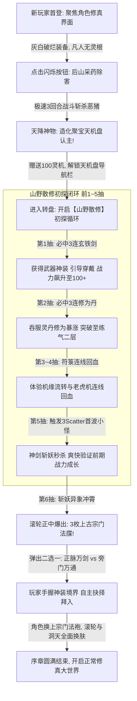
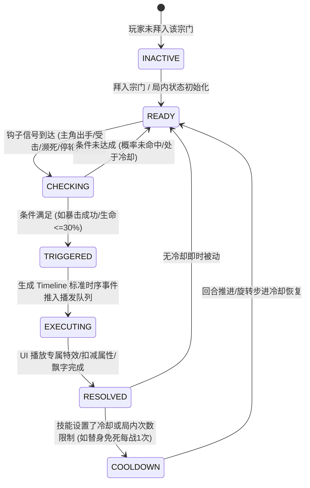
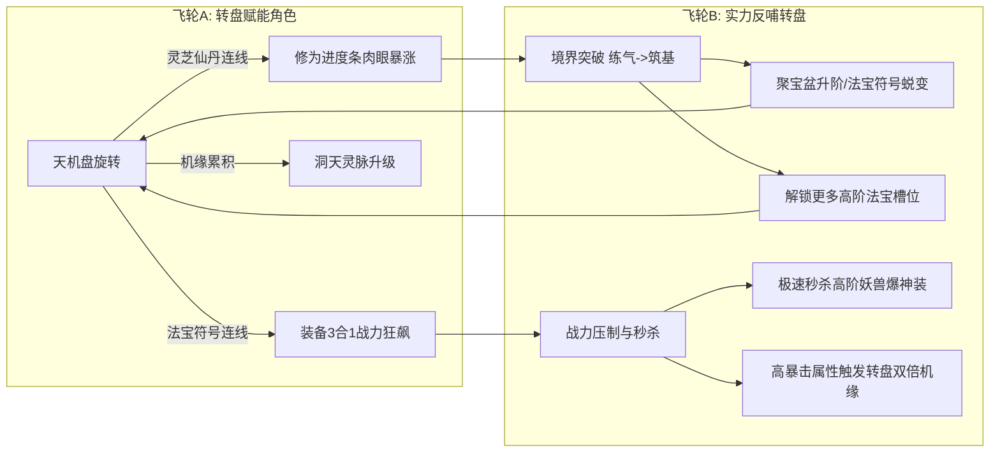

# 《修仙作弊器：造化聚宝盆》剧情与轮回宗门系统需求规格书 (PRD)

---

## 1. 系统概述与设计动机

### 1.1 背景与核心目标
在《修仙作弊器：造化聚宝盆》现有的 Slots 推演与 RPG 战斗养成基础上，引入深度网文沉浸感与长线 Roguelite 轮回玩法：
1. **确立主角叙事身份**：从一介无灵根凡人采药童子起步，偶得金手指“造化天机盘”，打破修仙界铁律；
2. **赋予转盘流派差异**：不同宗门赋予不同的心法被动，并改变天机盘滚轮的符号权重与变率（方差），形成差异化流派；
3. **构筑元循环（Prestige）**：以“集齐 5 份上古飞升之秘”为终极解谜目标，通过九世轮回跨越不同宗门，最终白日飞升跃迁至更高阶的灵界宏观大地图。

---

## 2. 第一阶段：五大正统宗门与特殊宗门体系

### 2.1 世界观：太上分家与飞升残卷
三万年前天地大劫，上古圣地【太上混元道宗】崩解，仙典《太上混元飞升经》被五大真传弟子各取走 **1/5 残篇**，分别建立五行正统道脉。散落民间的旁门左道虽无真经，却在财富与速修上别具一格。

```
                                  ┌─── 1. 万剑仙宗 (金·极道杀伐)
                                  ├─── 2. 太乙丹霞宗 (木·回春长青)
【太上混元道宗】 (上古完整仙典) ──┼─── 3. 御兽玄机门 (水·驱兽伏妖)
                                  ├─── 4. 天机神阵门 (土·奇门控盘)
                                  └─── 5. 焚天九幽道 (火·绝地逆命)
```

### 2.2 五大正统宗门规格表 (The 5 True Sects)

| 宗门名称 | 五行 | 对应洞天灵脉地图 | 持有真·飞升残卷 | 宗门专属心法加成 | 滚轮概率与变率异变 |
| :--- | :---: | :--- | :--- | :--- | :--- |
| **万剑仙宗** | 金 | **天剑绝壁 · 问剑峰**<br>*(断剑倒插，剑气嘶鸣)* | `【混元飞升经·剑破天门篇】` | **破虚剑芒**：攻击 $+25\%$，暴击率基础提升至 $20\%$；攻击 $30\%$ 概率追加二段飞剑突刺。 | **高波动爆发流**：飞剑符号权重 $+50\%$；连线 $25\%$ 概率触发【剑意破界】机缘翻 3 倍。 |
| **太乙丹霞宗** | 木 | **药王圣境 · 青木仙谷**<br>*(灵瀑飞悬，药香四溢)* | `【混元飞升经·九转仙魄篇】` | **乙木长青**：生命上限 $+35\%$，防御 $+15\%$；战中气血丹效果提升至 $+65\%$，开局带回春护盾。 | **低波动稳定流**：仙丹与灵草权重 $+60\%$；空转时 $30\%$ 概率草木回灵自动掉落仙丹。 |
| **御兽玄机门** | 水 | **大荒万兽天窟**<br>*(百兽啸聚，蛮荒古林)* | `【混元飞升经·百灵化神篇】` | **驱灵唤兽**：开局附带青灵狼协助攻击；每击破 1 头妖兽，战力临时叠加 $+3\%$。 | **战斗驱动流**：Scatter 妖兽遭遇率 $+40\%$；战胜掉落额外 $+1$，极品法宝爆率翻倍。 |
| **天机神阵门** | 土 | **悬空星罗浮岛**<br>*(八卦悬浮，星轨交织)* | `【混元飞升经·周天星斗篇】` | **奇门遁甲**：防御 $+30\%$，致命伤触发免死回血 $20\%$；战斗胜利返还 $50\%$ 推演机缘。 | **顺滑控盘流**：八卦阵 Wild 权重 $+45\%$；秘境 Hold & Spin 触发率翻倍；极难出现破产空转。 |
| **焚天九幽道** | 火 | **无间业火焦土**<br>*(地脉熔岩，紫黑魔焰)* | `【混元飞升经·涅槃焚天篇】` | **舍身燃血**：生命每降 $10\%$ 攻击 $+12\%$（残血上限 $+100\%$）；破魔符伤害翻倍并引动天雷。 | **超高风险暴击流**：普通小奖期望降低 $20\%$，但高阶至宝符号赔率提升至 $2.5$ 倍。 |

### 2.3 特殊与功能性干扰宗门 (Decoy / Functional Sects)
不含有真·飞升残卷，但提供不可替代的战略“功能性特权”，由玩家在转盘中自愿抉择：

1. **【万通多宝商行】（纯打金 / 传家宝流）**：
   - *定位*：世俗巨富建立的修仙商会，不求飞升只求敛财；
   - *滚轮异变*：灵机产出翻 $2.5$ 倍，Wild 符号满屏流转；
   - *核心特权*：**【乾坤传家】**——通关后允许玩家自选 **2 件顶级神装 + 5 颗极品仙丹**放入转世锦囊带入下一世！
2. **【钦天观星监】（情报与雷达 / 防卡关保底）**：
   - *定位*：避世苦行算命术士，掌握天下正统古令线索；
   - *滚轮异变*：快速凑齐 Hold & Spin 锁珠玩法，平稳速通；
   - *核心特权*：**【寻龙天枢盘】**——通关后获得下世保底道具，**下一世轮回时，100% 必定精准自选玩家尚未收集的正统宗门**。
3. **【九死血魂魔宗】（高风险速刷 / 随时夺舍重开）**：
   - *定位*：手握错误残篇【伪·血灵经】的邪道速成门派；
   - *滚轮异变*：频繁扣除气血换取超高连线暴击；
   - *核心特权*：**【血祭夺舍】**——推图极快如割草，允许玩家**随时无惩罚主动轮回重开**，并保留当前境界 $50\%$ 属性。

---

## 3. 第二阶段：凡人序章、散修初探与仙门引荐

### 3.1 散修初探至仙门引荐动线 (约 90~150 秒)



### 3.2 详细规格说明
1. **初始凡人状态**：
   - 界面锁定：底部导航栏的老虎机与洞天被古老云雾遮蔽（展现 🔒 锁头）；
   - 角色面板：境界 `凡人境 · 未入道`，气血 100，攻击 8，防御 2，战力 18；
   - 初始破烂：武器【锈蚀柴刀】(攻+3)、衣服【粗麻破衣】(血+10)、腰带【草编麻绳】(血+10)。
2. **教学首战：后山惊魂**：
   - 怪物：`后山恶兽 · 嗜血黑鬣猪` (血量 60，攻击 3)；
   - 3 回合极速自动劈砍，第 3 回合柴刀会心暴击击杀野猪。
3. **金手指作弊器觉醒**：
   - 八卦流光爆发展现全屏弹窗：*“检测到宿主凡躯逆境斩凶，上古禁忌神物【造化聚宝天机盘】觉醒认主！”*
   - 获得启动灵机 $+100$ 点，底部老虎机栏位锁头炸裂，身份进入【山野散修】阶段。
4. **【山野散修】前置教学小闭环 (第 1~5 抽，配置驱动)**：
   - **第 1 抽（初试天机 · 爆神兵）**：必出 3 连【玄铁剑】（`SYM_06`），背包提示红点，强引导玩家前往角色面板穿戴，战力从 18 跃升至 120+，直观确立“转盘能出神装”心理认知；
   - **第 2 抽（灵丹通脉 · 突境界）**：必出 3 连【纯阳修为丹】（`SYM_05`），修为经验条暴涨，当场突破至【练气二层】，确立“转盘驱动升级”心理认知；
   - **第 3~4 抽（气运流转 · 学回血）**：常规符箓小奖连线，返还机缘，理解 Slots 核心的“以战养盘、机缘流转”；
   - **第 5 抽（小试牛刀 · 斩群妖）**：盘面出现 3 枚 SCATTER 妖兽符印，触发 3 头初阶妖兽伏妖战。此前换上的神装与修为在此刻得到降维打击验证，主角一剑秒杀首怪、2 回合清场。
5. **延后触发：天象冲霄 · 仙门递牒 (第 6 抽高潮)**：
   - 首波小妖斩灭后，作弊器神念传音：*“宿主斩妖引动天地异象，千里之外名门仙山勘测仙仪震动，仙门巡察使亲临递来接引法牒！”*
   - 玩家点击第 6 抽，转盘引动五色神光，正中必定爆出 **3 枚【宗门引荐法牒】**；
   - 停轮瞬间**立即锁死转盘按钮并消除延时**，无缝弹出【叩问仙门】二选一界面：
     - 正统玄门：【万剑仙宗令】（金系暴击、飞剑轰鸣、通关产出剑魄残卷）；
     - 外道旁门：【万通多宝商行令】（万宝商道、机缘返利、通关封存跨世传家宝）；
   - 玩家已然理解游戏机制并具备基础战力，满怀期待自主抉择拜入，序章圆满结束，状态机置为正式修真者（`prologueStep = 4`, `isPrologueComplete = true`）。
6. **配置化工程原则（FTUESequenceConfig）**：
   - 严禁在业务代码中硬编码 `if (spinCount === 2)` 或硬塞符号；
   - 新手前 6 抽的脚本化序列、产出符号、引导对白、目标门派池全部抽离至 `FTUESequenceConfig` 配置表中，支持数值策划零代码热调。

---

## 4. 第三阶段：宗门大捷、飞升解谜与九转轮回

### 4.1 升仙天碑与五卷归一 (Ascension Puzzle)
- 在角色/洞天面板常驻【🏛️ 升仙天碑】UI：
  - 呈列 5 块凹槽拼图：`[金] 剑破天门篇`、`[木] 九转仙魄篇`、`[水] 百灵化神篇`、`[土] 周天星斗篇`、`[火] 涅槃焚天篇`；
  - 未收集残篇显示为灰色古石轮廓，点击展示寻访线索；
  - 收集到的残篇绽放金红神光，并提供永久常驻加成（如剑篇永久攻击 $+5\%$）。

### 4.2 九转轮回机制 (Samsara Loop)
当通关当前宗门或选择坐化兵解时，开启轮回转世：

- **单世重置项**：当前境界等级、聚宝盆等级、普通背包装备；
- **神魂永存项（消除被剥夺感）**：
  1. **飞升天碑残卷进度**（绝对不丢失）；
  2. **宗门通关心法精魄**（已通关宗门的心法转化为微量永久被动，多世后兼收并蓄）；
  3. **转世传家宝**（商行打包的神装，开局直接装备，体验大号割草爽感）；
  4. **寻龙天枢罗盘**（钦天监产出，下世必定定向刷出未获得的正统宗门）；
  5. **轮回功德池**（根据消耗灵机折算点数，在轮回殿自选基础属性增益）。

### 4.3 白日飞升与大地图跃迁 (Macro Map Shift)
- 当天碑集齐 5/5 块正统飞升残卷时，触发【天门大开 · 白日飞升】终极渡劫天雷；
- 成功飞升后，世界跃迁至 **【灵界 · 飘渺仙域】（第二大地图）**：
  - **洞天灵脉彻底质变**：从凡间洞府进化为悬浮在星河之上的【鸿蒙浮岛 · 星天仙阙】；
  - **天机盘神格化**：滚轮符号升级为灵界仙符（下品灵石 $\rightarrow$ 极品仙晶，凡铁法宝 $\rightarrow$ 洪荒通天灵宝）；
  - **高维境界解锁**：开放化神、炼虚、合体、大乘境界！

---

## 5. 核心逻辑与技术架构设计 (Technical Architecture)

### 5.1 状态机与持久化 Schema (`StorageService.js`)

```javascript
// 全局跨世存档结构 (持久化至 LocalStorage)
const GlobalSaveSchema = {
  // 1. 序章状态
  isPrologueComplete: false,
  prologueStep: 0,

  // 2. 当前世状态
  currentSectId: 'sect_sword',
  currentWorldTier: 1, // 1: 人界, 2: 灵界仙域

  // 3. 跨轮回 Meta Progression (核心资产，轮回不丢)
  metaProgression: {
    samsaraCount: 0,
    collectedFragments: ['fragment_sword'], // 已点亮残篇
    masteredSects: [],                     // 已通关宗门精魄
    guaranteedNextSect: null,              // 下世必出指定门派
    heirloomItems: [],                     // 传家宝装备 (免受重置)
    karmaPoints: 0                         // 轮回功德点
  }
};
```

### 5.2 滚轮平衡与 RTP 恒定性模型
- **物理返奖率（RTP）恒定锚定**：全宗门基础返奖率统一控制在 **$92\% \sim 95\%$**；
- 宗门仅改变变率（方差）：
  - 剑宗/九幽道：提高大奖爆发，拉长空转周期（高波动）；
  - 丹宗/神阵门：提高小奖、回血与 Wild 触发，平稳运行（低波动）；
  - 杜绝因选择宗门导致游戏内经济崩溃。

---

## 6. 全局缺漏排查、防呆准则与死锁规避方案 (Comprehensive Safeguards)

在系统宏观闭环的基础上，为防范逻辑死锁、数值暴走、沉没成本挫败与并发冲突，确立以下 4 大维度、共 10 条不可逾越的刚性规约：

### 6.1 玩法闭环与逻辑防呆（杜绝死锁与卡关）
1. **动态加权防卡碎片算法**：
   - 掉落引荐令时，**未收集过飞升残卷的正统宗门基础权重提升 $300\%$**；
   - 规则硬保底：**每次引荐令掉落（3 枚令牌中），必定至少有 1 枚是玩家尚未收集的正统门派**（除非 5 卷已全部集齐），彻底杜绝“连刷 3 世抽不到最后 1 块碎片”的挫败感。
2. **散功坐化逃生通道（防卡关死锁）**：
   - 若玩家因加点错误或战力不足打不过本门最终 Boss，且转盘灵机耗尽，角色面板激活【散功坐化 / 兵解转世】按钮；
   - 只要达到练气五层以上，允许随时自愿兵解；虽拿不到该门飞升残卷，但能按当前进度折算部分功德点并开启下一世，绝不陷入死锁。
3. **飞升第二大地图（灵界）的承接法则**：
   - 飞升不是删档，而是**“世界阶位跃迁（World Tier Up）”**；
   - 飞升后主角直接晋升为【化神境初期】，人界 5 块残卷合一升华成本命神器【太上混元仙牒】；
   - 人界凡铁淘汰，灵界全面解锁 5 大仙界更高阶道统与通天灵宝，开启灵界更高维度的飞升大循环。
4. **二世及后续轮回跳过序章（Skip Prologue）**：
   - 凡人序章（后山打猪觉醒天机盘）**严格只在第一世触发**；
   - 第 2 世及后续轮回，剧情表现为“金光划破轮回胎海，宿主携天机盘转世降生”，直接跳过打猪，开局立即从转盘选新宗门起步。

### 6.2 数值模型与经济安全（防通胀与崩盘）
5. **万通商行“传家宝”上限与覆盖限制**：
   - 跨世传家宝设立严格独立上限：**最多只能封存 1 把武器 + 1 件衣服**；
   - 再次加入商行带走新神装时，自动覆盖旧传家宝，杜绝无限套娃囤积神装导致数值崩塌。
6. **“天机暴击”纳入预算（防无限印钞）**：
   - 主角高暴击率触发的“转盘中奖翻倍”，严禁作为系统外额外增益；
   - 必须纳入万剑宗专属数学模型：基础连线赔率轻微下调 $15\%$，由天机暴击拉回期望，**严格将综合物理 RTP 锁死在 $94\%$ 安全线内**。
7. **灵机耗尽的“打坐吐纳”绝对兜底**：
   - 当玩家灵机归零、背包无药、洞天未产出时，转盘按钮变为【🧘 打坐吐纳】；
   - 点击播放 3 秒聚气呼吸特效，直接恢复 30 点基础灵机（每日限次或带短冷却），保证游戏永不卡死停滞。

### 6.3 技能管线与战斗时序冲突规避
8. **多怪同屏阵列下的技能目标类型（Target Type）**：
   - 技能配置必须显式声明 `targetType`：
     - `CURRENT_FOCUS`（当前锁定单体）：如万剑宗二段连环斩，紧咬当前集火目标追刀；
     - `ALL_ALIVE`（全员存活溅射）：如九幽道魔火，对场上所有存活怪物卡片造成 AOE 溅射；
     - `RANDOM_ALIVE`（随机存活目标）：如灵狼扑咬，随机补刀。
9. **多技能并发时的执行优先级队列（Hook Priority）**：
   - 钩子内部按优先级降序严格执行：
     - `Priority 100（吸收减免层）`：如太乙青莲护盾，最先吸收伤害；
     - `Priority 50（增减伤结算层）`：计算防御与易伤加成；
     - `Priority 10（致死保命层）`：如神阵门替身草人，最终判定伤害致死时方才消耗触发。

### 6.4 交互体验与知情权防呆
10. **正统与旁门宗门“大印透传”，杜绝误解 Bug**：
    - 宗门令牌卡片右上角必须有极其醒目的印章：
      - 正统五宗：金色大印 `【正统 · 承载飞升真卷】`；
      - 特色商行：紫色大印 `【旁门 · 虽无飞升卷，但可带神装】`；
    - 通关结算时明确文案提示：“本门为万通商行，特赐予乾坤传家神装！若求飞升之秘，请于下世拜入五大正统！”，彻底杜绝玩家以为“没掉残卷是出 Bug”。
11. **老存档平滑兼容准则**：
    - 若本地存档已有修为或已达聚宝盆 1 级以上，`isPrologueComplete` 默认置为 `true`，分配缺省宗门或弹出一次【溯源选宗】，绝不破坏老玩家数据。

---

## 7. 门派技能状态机与生命周期管线设计 (Skill Architecture)

### 7.1 门派技能双层矩阵（天机心法 + 伏妖绝学）

每个宗门具备两层技能表现，杜绝单纯的数值皮囊：

| 宗门名称 | 第一层：天机心法 (滚轮/挂机机制) | 第二层：伏妖绝学 (战斗时序与特效) |
| :--- | :--- | :--- |
| **1. 万剑仙宗** *(金·极道杀伐)* | **【剑气如虹】**：飞剑符号高权重，连线 $25\%$ 概率触发 3 倍剑意破界机缘 | **【万剑归宗 · 连环斩】**：普通攻击 $30\%$ 概率追加 1 次不占回合的二段破空飞剑突刺，伤害为攻击力 $60\%$ |
| **2. 太乙丹霞宗** *(木·回春长青)* | **【草木回灵】**：转盘空转未中奖时，$30\%$ 概率自然凝聚掉落 1 枚灵丹；挂机灵机产出 $+35\%$ | **【太乙青莲护体】**：开局自带青莲护盾，抵消首道伤害；气血丹效果提升至 $+65\%$，濒死自发生效 |
| **3. 御兽玄机门** *(水·万兽统领)* | **【万兽来朝】**：Scatter 妖兽遭遇率 $+40\%$，战胜额外掉落 $+1$，极品法宝爆率翻倍 | **【青灵狼袭】**：常驻召唤灵狼助战，主角出手后灵狼扑咬补刀 $35\%$ 伤害；每击杀 1 怪全员战力 $+5\%$ |
| **4. 天机神阵门** *(土·奇门控盘)* | **【奇门借势】**：八卦 Wild 出现率 $+45\%$，秘境 Hold&Spin 触发率翻倍；战胜返还 $50\%$ 推演灵机 | **【移形换位 · 替身咒】**：受致命伤必定消耗草人免死 1 次并回血 $25\%$，将该回合伤害 $50\%$ 反弹敌方 |
| **5. 焚天九幽道** *(火·逆命孤勇)* | **【天魔狂赌】**：普通小奖期望降 $20\%$，高阶神物赔率暴增至 $2.5$ 倍（超大方差） | **【九幽焚天斩】**：血量越低伤害越高（每降 $10\%$ 血增伤 $15\%$），暴击引动九幽魔火全场溅射 |
| **6. 万通多宝商行** *(特色·打金遗产)* | **【富甲仙途】**：转盘灵机产出 $2.5$ 倍，通关允许带走 2 件顶级神装至下一世 | **【千金一掷】**：战中可消耗灵机强化攻击；击杀妖兽额外爆出海量灵石包 |
| **7. 钦天观星监** *(特色·寻龙雷达)* | **【天机烛照】**：极易触发秘境玩法；通关获【寻龙盘】，下世必出未获得的正派 | **【天算破绽】**：使敌方首领防御永久降低 $35\%$，让主角所有攻击必定破甲 |
| **8. 九死血魂教** *(特色·狂暴速刷)* | **【血祭转运】**：允许随时无损主动轮回重开；推图速度翻倍，割草速刷 | **【血煞解体】**：主动引爆自身 $20\%$ 气血释放全屏血浪，造成巨额真实伤害 |

### 7.2 技能状态机生命周期 (Skill State Machine)

技能不采用零散调用，统一抽象为具备严密生命周期的有限状态机（FSM）：



### 7.3 生命周期钩子管线 (Hook Pipeline) 与零侵入维护原则
为彻底杜绝在战斗引擎与转盘引擎中到处写 `if (sect === 'xxx')` 导致代码难以维护，确立**“生命周期钩子管线 + 声明式技能注册表”**架构：

1. **业务引擎只广播钩子（纯计算，零门派耦合）**：
   - 战斗钩子：`ON_BATTLE_START`（开局进场）、`BEFORE_PLAYER_ATTACK`（攻击前算增伤）、`AFTER_PLAYER_ATTACK`（攻击后追加斩击）、`ON_TAKE_DAMAGE`（受击护盾/替身免死）；
   - 转盘钩子：`ON_REEL_WEIGHT_CALC`（计算符号权重）、`ON_SPIN_EVALUATED`（结算后加倍）、`ON_SPIN_NO_WIN`（空转未中掉丹）；
2. **声明式技能配置表 (`SectSkillRegistry.js`)**：
   - 每个技能自包含触发条件、数值公式、时序事件生成逻辑与 UI 特效名称；
   - 策划或开发新增/修改门派技能时，**仅需修改单一配置文件，核心代码 0 改动**。

---

## 8. Slots 与修仙养成双向驱动飞轮模型 (Feedback Loop)

### 8.1 双向驱动飞轮体系
拒绝“左手倒右手”的无意义纯筹码数字膨胀，建立**“转盘为因，实力为果，以力破局，反哺神盘”**的双向正循环：



### 8.2 爽感三步递进闭环（将奖励转化为实打实的快感）
1. **步骤 1：具象化吸收（“看得见这堆东西进了我的身体”）**
   - 转盘开出丹药或法宝时，严禁静默入库；
   - 宝箱炸开，丹药与法宝化为抛物线流光直入底部角色修真面板；修为进度条在屏幕上**肉眼可见地从 30% 暴涨至 80%**，并伴随翡翠波纹与声效。
2. **步骤 2：即时战力狂飙（“我马上变强了！”）**
   - 玩家进入修真界面一键升阶或拖拽换上新法宝；
   - 界面正中立即爆发大字弹射（绿字涨、红字跌）：`⚡ 战力 +180！`、`⚔️ 攻击 +45！`，战力数字飞速跳变，给玩家最强烈的成长确定感。
3. **步骤 3：战斗中的“数值碾压验证”（爽感的终极高潮）**
   - 刚换完神装，下一把转盘立刻触发 3 Scatter 妖兽围攻；
   - 此前需要苦战 10 回合的群怪，现在主角一道飞剑暴击大字 `-120`，**直接一剑秒杀首怪、2 回合清场**；
   - **“刚才转出来的战利品，立刻在此刻完成了降维打击的实力验证”**，构成无法自拔的修仙爽感。

### 8.3 完整中奖事件与战力成长映射表

| 转盘中奖事件 | 产出的具体奖励 | 对角色实力的直接帮助 | 玩家在游戏里切身体验到的爽感 |
| :--- | :--- | :--- | :--- |
| **常规符号小奖** | 灵机金币 + 基础修为 | 维持推演转盘体力，修为条微步前行 | 细水长流，点一下进一步，永不白给 |
| **丹药/灵草连线** | 九转气血丹 + 纯阳修为丹 | 气血丹成战中保命底牌；修为丹直接猛推升级条 | 经验条肉眼可见暴涨，多了一背包救命丹药 |
| **高阶法宝连线** | 对应部位装备箱 / 现成法宝 | 填补未解锁槽位，触发背包 3 合 1 升阶 | 换装飘出明亮翡翠大字（战力+180），属性暴涨 |
| **3~5 Scatter 妖兽** | 击败妖兽爆妖丹、大额机缘与宝箱 | 检验当下战力上限，打通突破关口 | 实力质检，看群怪被自己一剑斩灭爆满屏战利品 |
| **5 Bonus 洞天秘境** | Hold & Spin 结算海量累积灵机 | 提供升级聚宝盆、升阶洞天灵脉的核心资产 | 灵脉产出速率翻倍，转盘外框进阶为紫金八卦盘 |
| **宗门通关 / 轮回** | 1 份飞升残卷 + 永久宗门心法精魄 | 全世常驻属性加成（暴击+5%、生命+10%），传家宝带入下世 | 解开大解谜进度（1/5），下一世大号下凡神装割草 |

---

## 9. 纯 IAA 商业变现矩阵与激励视频触点设计 (Pure In-App Ads Specification)

### 9.1 合规政策与变现定调
- **政策背景**：国内游戏涉及真实货币内购（IAP）需要申请正式版号审批，周期极长。本项目定位于微信/抖音等轻量小游戏，**一律采用 100% 纯 IAA（In-App Ads，激励视频广告变现）模式**，彻底规避版号资质限制，实现零资质阻碍、极速合规上线。
- **设计哲学**：**绝不插入粗暴打断体验的插屏弹窗广告**，全部采用**高价值情境诱导的“玩家自愿主动点击型”激励视频（Opt-in Rewarded Video Ads）**，将广告点包装为仙道机缘，实现“玩家主动看、看完立刻给大爽感”。

### 9.2 六大黄金 IAA 激励视频触点矩阵

| 触点名称 | 触发心理场景 | 激励视频核心回报 (极高转化率) | 每日频次限制与防疲劳 |
| :--- | :--- | :--- | :--- |
| **1. 妖王绝地复活**<br>*(起死回生 · 九转还魂)* | 挑战宗门守关妖王时残血（$30\%$ 以下）不慎暴毙，差两刀通关，极度不甘心 | **立即 $100\%$ 满血复活**并获得 3 秒无敌护盾，绝地反杀 Boss！ | 每场战斗严格限 1 次<br>每日上限 3 次 |
| **2. 天降造化灵泉**<br>*(灵机断粮 · 极速续航)* | 转盘手感正热、差一点升级，但灵机恰好归零，不看广告需干等 2 小时 | 播放甘霖降世动画，**瞬间补满 60 点推演灵机**，立刻能转 30 盘！ | 每日上限 6 次<br>(看满进入打坐吐纳) |
| **3. 洞天离线双倍**<br>*(仙光普照 · 天官赐福)* | 离线数小时上线，洞天灵脉累积了数百灵机与多枚丹药，顺手一点翻倍 | **一键 $2$ 倍全额收取**灵脉机缘与修为仙丹，养成效率飞跃！ | 每日无硬性限制<br>(自然覆盖早中晚2~3次) |
| **4. 造化天工补全**<br>*(装备3合1 · 缺一门神助)* | 背包已有 2 件同名法宝，永远“3 缺 1”卡住大进阶战力瓶颈 | 借天道虚影**凭空凝聚最后 1 件同名同品质法宝**，当场大进阶！ | 每日上限 2 次<br>(每次使用间隔 10 分钟) |
| **5. 轮回重测仙缘**<br>*(主线防卡 · 重置引荐)* | 首次转盘摇出来的 3 个门派全重复，或急需正统五宗却全出旁门 | 借天算之力**重新洗牌刷新，换 3 枚全新宗门引荐令**！ | 每世限用 1 次<br>每日上限 3 次 |
| **6. 传家宝多带一件**<br>*(太虚锦囊 · 突破界限)* | 通关万通商行准备轮回转世，满背包极品神装舍不得丢弃 | 突破天道禁锢，**允许额外多封存 1 件神装**带入下世！ | 每世通关限 1 次 |

### 9.3 促活黑科技：【仙道功德 · 伪免广券体系】
为避免长期游玩产生广告疲劳，引入自驱激励机制：
1. **功德碑每日免广券**：
   - 界面常驻提示：`今日功德：[已看 X/5 个视频]`；
   - 玩家当日只要主动看满 5 个视频，系统立即赠送 **2 张【天机瞬发符（免广告直接领奖券）】**；
   - 遇到下一次想看的广告（如妖王暴毙需复活时），可直接消耗瞬发符“0 秒秒领复活”；
   - 极大促进了玩家在白天主动消耗灵泉广告的积极性。
2. **大里程碑赠送特权**：
   - 完成【首次飞升】、【击破 100 只妖兽】等终极成就时，打包赠送 5~10 张免广券，给予成就感补偿。

### 9.4 纯 IAA 商业效益模型预估 (中国市场 eCPM 测算)
以微信小游戏主流 eCPM 平均值 $80 \sim 150$ 元人民币为基准：

- **轻度玩家（日均看 4~6 次）**：每日贡献约 **$0.4 \sim 0.6$ 元**，7 天留存 LTV 约 **$2.5 \sim 4.0$ 元**；
- **中度核心玩家（日均看 8~12 次）**：每日贡献约 **$0.8 \sim 1.5$ 元**，7 天留存 LTV 约 **$6.0 \sim 10.0$ 元**；
- **重度冲关肝帝（日均看 15~20 次）**：每日贡献约 **$1.8 \sim 2.5$ 元**，7 天留存 LTV 约 **$12.0 \sim 18.0$ 元**；
---

## 10. 五维深度检视与好玩度体验润色准则 (Multi-Perspective Polish & Fun Factor)

为确保系统从“逻辑自洽的及格设计”跃升为“极度上头、口碑自传播的爆款作品”，从设计、玩家、技术、可玩性、爽感五大维度确立以下体验润色细则：

### 10.1 设计维度：心法兼容与冲刺紧迫感
1. **心法与通用装备的【触类旁通】机制**：
   - 装备属性保持“攻、防、血”基础通用，但各门派心法增加适配转换层；
   - 例如太乙丹霞宗心法增加特性：*“将所佩戴装备的 $20\%$ 攻击力转化为护盾底额”*，确保无论上一世带来何种传家宝装备，都能在该门派产生独特的流派质变。
2. **临近飞升的【九霄天象异变】**：
   - 当收集到 3/5、4/5 残卷时，主转盘背景天色由清朗逐渐变为**“九霄紫雷云海”**，天机盘外框产生古仙篆鸣动；
   - 最后一世所有宗门的妖兽掉落率与经验获取微调提速 $30\%$，营造“大世将临、临门一脚”的冲刺紧迫感。

### 10.2 玩家维度：消灭认知负担与心理落差
3. **初选宗门【1 秒看懂】大白话标签**：
   - 宗门令牌卡片最醒目位置标注极简人设总结，消灭新玩家面对数值表的迷茫：
     - *万剑宗*：`⚔️【纯暴力输出】：一剑秒怪，伤害爆表！推荐喜欢暴力爆发的道友`
     - *太乙宗*：`💊【不死回春流】：容错极高，挂机超快！推荐喜欢稳健放置的道友`
     - *多宝商行*：`💰【暴富打金流】：疯狂爆灵石，可带神装下山！推荐喜欢攒家底的道友`
4. **轮回转世的【九世宿慧觉醒】仪式感**：
   - 轮回严禁直接突兀清空属性，必须播放青金色【九世宿慧归一】动画；
   - 继承的传家宝在开局伴随剑鸣直接装备上身，并根据前世功德点**开局直升练气二至三层**，让玩家瞬间感受到“携神功重修大能”的割草爽感。

### 10.3 可实现维度：纯前端高性能架构守则
5. **纯前端矢量 SVG + CSS3 动画铁律**：
   - 绝不引入大型第三方骨骼/3D 动画引擎；
   - 所有门派技能（万剑飞剑突刺、太乙青莲护盾、御兽青灵狼）全部采用**轻量定制矢量 SVG + 原生 CSS 关键帧驱动**，性能开销趋近于零，千元机流畅跑满 60 帧。

### 10.4 可玩性维度：打通割裂与护肝体验
6. **转盘界面【洞天灵气浮泡】一键收菜**：
   - 在老虎机界面角落悬浮微型仙鼎气泡：`洞天灵机已满 80`；
   - 玩家在前台连续推演时**无需切换至洞天 Tab，直接单点气泡即可将灵气一键吸入转盘总额中**，打通双系统互动。
7. **自动推演【高光智能停机】保护**：
   - 自动推演设置智能保护阀：一旦摇出【3+ 妖兽围攻】、【5+ 洞天秘境】或【极品橙色法宝】，自动推演瞬间刹车并高亮定格，确保玩家绝不错过任何大奖快感。

### 10.5 好玩度与修仙爽感：网文灵魂注入
8. **作弊器嘴炮吐槽与同门震惊动态语料库**：
   - 转盘上方对话框不仅报数字，更根据事件随机吐出轻量幽默的修仙网文弹幕：
     - *刚入宗门时*：`【天机作弊器】：“检测到宗门外门执事在打瞌睡，悄悄顺走他一袋灵石...”`
     - *暴击秒杀妖兽时*：`【同门师妹】：“天呐！师兄这一剑平平无奇，为何竟恐怖如斯？！”`
     - *连线爆大奖时*：`【万剑宗太上长老】：“此子悟性逆天，实乃我宗万载不遇之麒麟仙胚！”`
9. **偶发性终极大高潮：【天道显圣 · 气运之子大满贯】**：
   - 设立极低触发率（$1\% \sim 1.5\%$）的神经刺激高光点；
   - 触发时天地骤暗，金龙长啸，本局全屏符号强制转化为八卦百搭（All-Wild Mega Win），灵石与光效喷涌：
     `【天道作弊器报警】：“警告！强行夺取了天地万载气运，本轮机缘暴涨 10 倍！”`
   - 为玩家创造可截图、可炫耀的终极高光时刻。

---

## 11. AI 美术与视听工业化落地规格 (香蕉 / Gemini 视频与生图方案)

### 11.1 AI 生产力定位与分工铁律
依托现代生成式 AI 工具流（香蕉 / SD / Midjourney 负责高质量静态资产；Gemini / Veo / 即梦 / 可灵负责电影级动态视频），以极低成本实现媲美 3A 国风微电影的视听质感。

为确保在微信小游戏及纯前端运行环境下的极致流畅与零卡顿，确立严格的**“视听资产三级分工铁律”**：
1. **S 级高光过场（采用 AI 视频）**：仅在飞升、作弊器觉醒、洞天挂机微动态等**低频/高情绪节点**使用短视频；
2. **A 级立绘与界面（采用 AI 高清静态生图）**：宗门大地图、令牌、升仙天碑、角色立绘，采用 512px / 2K 静态 WebP/PNG；
3. **B 级高频战斗与转盘（采用 AI 单体素材 + CSS3/Canvas 代码驱动）**：飞剑突刺、护盾、转轴符号绝对不用视频，采用轻量透明图 + 代码关键帧动画（0.3秒极速响应，零内存压力）。

---

### 11.2 S 级高光 AI 视频生成需求与 Prompt 规格 (Gemini Veo / 可灵 / 即梦)

所有视频严格压缩为 **720P / 1080P MP4 或 WebM 格式**，单段视频体积必须控制在 **$1\text{MB} \sim 2.5\text{MB}$** 内，静音或自带微音效，通过 HTML5 `<video>` 标签全屏弹窗播放。

| 视频资产名称 | 播放时长与模式 | 播放情境与心理目标 | AI 视频生成标准 Prompt (可直接复制) |
| :--- | :---: | :--- | :--- |
| **`cutscene_ascension.mp4`**<br>【白日飞升 · 天门大开】 | 4 ~ 5 秒<br>(单次全屏播放) | 达成 5/5 残卷终极飞升，引动九霄雷劫，天地造化，多巴胺达到顶峰 | `Cinematic fantasy cutscene, Chinese Xianxia Taoist Heavenly Gate opening in cosmic starry sky, towering ancient jade and bronze celestial gate slowly cracking open, blinding golden divine light beam shooting down through dark thunderclouds, purple lightning arcs, epic scale, 8k resolution, photorealistic, cinematic camera moving forward, Unreal Engine 5 aesthetic, masterpiece.` |
| **`cutscene_artifact_awaken.mp4`**<br>【天机现世 · 作弊器认主】 | 3 秒<br>(单次全屏弹窗) | 凡人首战斩杀黑鬣猪后，青铜宝盘破土而出、八卦星图旋转认主，网文爽感拉满 | `Close-up shot of an ancient mythical Chinese bronze Bagua artifact bursting out of dark ground, covered in glowing golden inscriptions, spinning in midair, radiant cyan and gold aura expanding outwards, dust and magical embers flying, dynamic lighting, cinematic slow motion, 8k.` |
| **`bg_cave_sword_loop.mp4`**<br>【问剑峰 · 孤绝风雪循环】 | 4 秒<br>(无缝静音平滑微循环) | 作为万剑仙宗【洞天灵脉】动态背景，营造活生生的修仙洞府沉浸感 | `Atmospheric ambient looping scene, a lonely desolate mountain peak piercing through sea of clouds, thousands of ancient broken flying swords thrust into stone cliffs, subtle wind blowing white mist and glowing cyan spirit embers, Chinese dark wuxia, 4k, peaceful cinematic motion, seamless loop.` |
| **`bg_cave_pill_loop.mp4`**<br>【青木仙谷 · 灵瀑药田循环】 | 4 秒<br>(无缝静音平滑微循环) | 作为太乙丹霞宗【洞天灵脉】动态背景，展示灵泉飞泻、仙芝吐纳之生机 | `Atmospheric ambient looping scene, an ethereal Chinese medicinal valley surrounded by emerald waterfalls, giant glowing spiritual mushrooms and lotus flowers breathing soft cyan light, gentle mist rising, peaceful cinematic motion, seamless loop.` |

---

### 11.3 A 级静态美术与令牌生成需求 (香蕉 / SD / Midjourney)

所有静态素材统一放置在 `assets/` 对应子目录中，采用透明背景 PNG 或极致压缩的 WebP 格式：

#### 1. 宗门引荐令法牒 (512 × 512 px 透明 PNG)
- **存放路径**：`assets/sects/tokens/`
- **【万剑仙宗令 (`token_sword.png`)】**：
  > `An epic Chinese Taoist Sect Token (Tailing), made of dark obsidian and Damascus steel, shaped like a miniature celestial flying sword, carved with glowing gold sword runes, floating in dark void, sharp rim light, 3D Octane render, luxury game asset icon, transparent background, 8k --v 6.0`
- **【太乙丹霞宗令 (`token_pill.png`)】**：
  > `An ancient emerald jade Sect Token shaped like a blooming sacred lotus holding an elixir pill, soft cyan and golden spiritual mist, glowing Taoist cinnabar engravings, luxury mobile RPG item icon, transparent background --v 6.0`
- **【御兽玄机门令 (`token_beast.png`)】**：
  > `A primitive savage beast-bone Sect Token carved from a prehistoric dragon tooth, glowing amber beast runes, bound with rough red cord, feral spiritual aura, dark background, 3D render icon --v 6.0`
- **【天机神阵门令 (`token_array.png`)】**：
  > `An intricate octagonal bronze astrolabe Sect Token with rotating celestial rings and glowing star constellation dots, ancient Bagua symbols etched in liquid gold, luxury game icon --v 6.0`
- **【焚天九幽道令 (`token_fire.png`)】**：
  > `A menacing dark red Sect Token forged from hellfire meteor iron, jagged demonic horns framing burning purple nether flame, dripping embers, dark fantasy RPG crest icon --v 6.0`
- **【万通多宝商行金令 (`token_merchant.png`)】**：
  > `A luxurious Chinese treasure guild golden medallion, pure solid gold coin shape adorned with dragons holding jade ingots, sparkling gold coins and red silk tassels, wealthy merchant crest --v 6.0`

#### 2. 上古升仙天碑与 5 块拼接残卷 (512 × 512 px)
- **存放路径**：`assets/ascension/`
- **【天碑凹槽底盘 (`stele_base.png`)】**：
  > `An ancient monolithic weathered grey stone stele with five carved puzzle indentations in a circle, faint astrological star map carved into stone, mysterious ancient Chinese relic, dark background.`
- **【飞升残篇古石 (按金木水火土生成 5 块拼图石板)】**：
  > `A single ancient carved stone puzzle tablet piece, jagged natural rock edge fitting into an altar, covered in glowing liquid gold Taoist seal script, radiant celestial relic, transparent background, 3D render.`

---

### 11.4 B 级高频战斗特效与伴生灵兽轻量化规范

为确保手机端绝对不卡顿，战斗中的技能与伴生宠物遵循 **“AI 单体透明图 + CSS3/SVG 关键帧驱动”**：
1. **御兽门【青灵狼】**：
   - 用香蕉生成一张透明背景的 `wolf_companion.png`（灵动幽蓝苍狼）；
   - 战斗时作为主角身侧的一个固定挂件，在主角出手后执行 `@keyframes wolfPounce`（0.25 秒前扑撕咬），极度轻快，零代码负担；
2. **太乙宗【太乙青莲护盾】**：
   - 生成一张半透明发光青莲图 `fx_lotus_shield.png`；
   - 主角进场时套在角色立绘周围，附带缓和呼吸动效（`animation: shieldBreathe 3s infinite`），受击时播放碎裂粒子消散。

---

### 11.5 前端加载与资源热替换工程实现

```javascript
// 资源动态适配机制 (自动嗅探：若有视频则播视频，无视频优雅回退为动态 CSS)
function playAscensionCutscene(onComplete) {
  const video = document.getElementById('ascension-video');
  if (video && video.canPlayType('video/mp4')) {
    video.src = 'assets/video/cutscene_ascension.mp4';
    video.classList.remove('hidden');
    video.play();
    video.onended = () => {
      video.classList.add('hidden');
      if (onComplete) onComplete();
    };
  } else {
    // 降级回退方案：播放 CSS 金光大阵全屏粒子
    playFallbackParticleAscension(onComplete);
  }
}
```

---

## 12. 深度优化规范：五行天碑法相殿、Boss门票掉落、装备起跑线与隐藏奇遇门派体系

为了进一步拉长游戏健康生命周期、强化天机盘爆装惊喜感、满足玩家“集邮/英灵殿”式长线成就，并实现更直观的数值膨胀正反馈，特对轮回、装备、天碑与宗门架构进行全面升级。

### 12.1 体系重构核心原则
1. **五行主线大圆满（明线）**：万剑(金)、太乙(木)、御兽(水)、天机(土)、焚天(火) 5 大正统宗门构成通关飞升的主干。每个宗门历练产出专属神装，通关后全套封存在天碑英灵殿中。
2. **隐藏秘境与客卿奇遇（暗线）**：万通商行、九死血魂教、钦天观星监脱离常规轮选，升华为“绝境彩蛋式隐藏门派”。玩家以客卿身份解锁随身道统，无需转生打断五行飞升，即时获得逆天被动。
3. **老祖转世·底蕴继承**：跨世转生时，旧装备归档封神，新门派装备从灰色起步重新享受合成爆发；但前世积累的基础属性 100% 沉淀为【先天道基】，使玩家手握灰装亦具老怪威能。
4. **Boss 掉落悬念与心跳**：守关妖王从 100% 送门票改为“概率掉落 + 动态防脸黑保底”，延长刷取追求与击败 Boss 翻牌的高光。

---

### 12.2 天碑真卷 · 宗门法相英灵殿 (Sect Pantheon Archives)

#### 1. 数据结构规范
玩家转世拜入新宗门时，当前穿戴的 5 件套装备不再换皮或销毁，而是完整深拷贝存档至天碑档案库：
```javascript
// AscensionManager.meta.sectArchives 结构
sectArchives[sectId] = {
  sectId: 'wanjian',
  sectName: '万剑仙宗',
  element: '金',
  completedAtSamsara: 1,           // 达成世数
  combatPower: 9240,               // 封神时的总战力
  stats: { hp: 1350, atk: 420, def: 210 }, // 当世达成属性
  equipment: {
    weapon: { name: '极道飞剑', qualityCode: 'Q3', stats: {...}, icon: '...' },
    armor:  { name: '天剑法袍', qualityCode: 'Q3', stats: {...}, icon: '...' },
    ring:   { name: '剑意灵戒', qualityCode: 'Q3', stats: {...}, icon: '...' },
    boots:  { name: '御剑踏云履', qualityCode: 'Q3', stats: {...}, icon: '...' },
    belt:   { name: '极道剑穗带', qualityCode: 'Q3', stats: {...}, icon: '...' }
  },
  sealStatus: 'consecrated'        // 'locked' | 'consecrated' (已归位)
};
```

#### 2. UI 交互与法相殿浮层
- 在【天碑真卷】界面，已点亮的门派图标（金木水火土）显示光晕与已封神徽记；
- 玩家点击对应门派图标，唤起【宗门大能法相殿】弹窗：
  - 顶部显示：`【万剑仙宗 · 金系真传法相】`；
  - 中央展示：玩家当世毕业穿戴的 5 件套神装（带专属品阶光框与图标）、结算战力与三维属性；
  - 底部印章：朱砂金印**【五行之金 · 已归位】**，极具仪式感与留念价值。

---

### 12.3 先天道基继承与新门派装备起步

#### 1. 属性沉淀与继承
- 拜入新门派时，上一世通过升级、丹药、心法累积的角色总裸装基础属性，**100% 累加沉淀至 `meta.legacyStats`**；
- 角色总基础属性公式：
  $$\text{BaseStats} = \text{CurrentRealmStats} + \text{LegacyStats}$$
- 这一机制确保了即使角色脱下全部装备，基础战力依然极高，彻底实现小说中“转世大能重修，底蕴盖压同阶”的爽感。

#### 2. 新门派装备起跑线
- 进入新门派后，主角换上该门派的 1 级基础灰白装备，背包清理；
- 玩家在每一个新门派，都能重新体验从 **灰(Q1) $\rightarrow$ 绿(Q2) $\rightarrow$ 蓝(Q3) $\rightarrow$ 紫(Q4) $\rightarrow$ 橙(Q5)** 完整的 3合1 极速合成心流；
- 避免了“带着旧门派高阶神装，新门派开局前 20 分钟装备全无收益”的索然无味。

---

### 12.4 天机盘掉落与跨阶大爆机制

天机盘掉落品质严格由双轴矩阵驱动（`DropMatrix(samsaraCount, potLevel, matchCount)`）：
- **常规掉落**：以当前门派对应的进阶品阶为主（从灰/绿起步）；
- **天机狂暴大爆（高光惊喜）**：
  - 当转出 **4 连** 时，有 $30\%$ 概率直接跃迁 1 阶；
  - 当转出 **5 连 / 包含百搭连线** 时，有 $15\%$ 概率触发**【天赐仙兵】**神降动效，跨级直出一整件**高 2 阶的极品神装（如直接出蓝/出紫）**！
  - 这一机制彻底释放了天机盘的刺激感，让玩家免去繁琐合成，当场战力飙升。

---

### 12.5 正统宗门入场券掉落重构 (Boss 概率掉落)

打破以往“通关必送门票”的单调设计，赋予击败 Boss 翻牌的强烈心跳感：
1. **掉落规则**：击败当前门派守关妖王（赤炼蟒 / 铁甲金猊等）时，判定是否爆出下一门派的【真传法牒】；
2. **概率与动态防脸黑保底**：
   - 首次击败：基础爆率 **$40\%$**；
   - 第二次击败（若首次未爆）：爆率提升至 **$75\%$**；
   - 第三次击败：**$100\%$ 保底必出**；
3. **心流增益**：若未爆出门票，玩家可继续在天机盘中冲刺当前门派装备的词条上限，追求全套极品后再战，极大丰富了每个门派的驻留探索时长。

---

### 12.6 五行合一 · 白日飞升终极大圆满

#### 1. 飞升判定条件
必须同时满足以下两大条件：
1. **五行法相齐聚**：天碑真卷中，金(万剑)、木(太乙)、水(御兽)、土(天机)、火(焚天) **5 大宗门的神装档案全部达成 Consecrated（5/5）**；
2. **斩断人界心魔**：在终极飞升秘境中战胜人界最终 Boss【太上混元心魔】。

#### 2. 飞升仪式与世界跃迁
- 天碑界面中，五方宗门法相同时射出金、绿、蓝、黄、红五色神光，于中央太极阴阳阵汇聚为灵界本命神物【太上混元仙牒】；
- 全屏播放五行归一飞升特效，角色境界跃迁至【灵界 · 化神初期】，解锁飘渺仙域宏大新篇章！

---

### 12.7 隐藏奇遇门派体系 (Hidden Sects & Guest Inheritance)

万通商行、九死血魂教、钦天观星监转为【隐藏绝境奇遇】。**玩家以“客卿传承”形式吸纳其独门神通，无需脱离当前五行门派转生，终身常驻！**

| 隐藏宗门 | 奇遇触发彩蛋 (绝境逆转) | 客卿传承仙印 | 独门逆天特权 (常驻生效) | 专属视觉与战斗反馈 |
| :--- | :--- | :--- | :--- | :--- |
| **万通多宝商行**<br>*(金财巨贾)* | **【天无绝人之路】**<br>玩家机缘消耗至 0 且救济次数耗尽时，虚空破碎，大掌柜破空救济 | **【万通·富甲诸天印】** | **金玉满堂**：天机盘推演每 10 次，必定天降元宝返还 100 灵机；角色基础攻击 $+15\%$。 | 攻击跳字伴随金币碰撞金石音效，暴击时金光四射。 |
| **九死血魂魔教**<br>*(禁忌血修)* | **【绝地丝血绝杀】**<br>挑战守关 Boss 时，生命值低于 $15\%$ 濒死状态下成功反杀 Boss 唤醒魔门 | **【九死·万劫不灭印】** | **嗜血逆命**：攻击造成的伤害 $20\%$ 转化为自身气血（吸血神技）；暴击率永久 $+15\%$。 | 暴击跳字变为猩红血煞，角色受击与攻击有血滴飞溅。 |
| **钦天观星监**<br>*(星宿天枢)* | **【因果星图逆转】**<br>天机盘连续 8 次空转未中奖、或摇出特定八卦阵符时窥破天机秘令 | **【钦天·观星逆命印】** | **天命倒流**：挑战 Boss 阵亡时，立即触发 1 次【时光倒流·免死满血复活】；全装备防御 $+20\%$。 | 濒死瞬间触发紫微星宿大阵，光罩覆体回满血量。 |

#### 天碑暗阁展现：
- 天碑真卷界面下方增设 3 个漆黑锁链缠绕的**【上古隐世暗阁】**；
- 触发奇遇并获得传承后，锁链断裂、黑雾消散，点亮璀璨暗金印章；
- 3 大隐藏印章全部集齐时，激活隐藏称号**【三界逆命仙尊】**，全属性额外加成 $+10\%$。

---

## 13. AI 协同与需求维护：Token 节约工程规范

在与 AI 结对编程、长线维护和迭代复杂游戏需求时，为避免 Context 恶性膨胀与 API Token 浪费（通常可节省 70% ~ 90% 消耗），项目团队应严格执行以下工程规范：

### 12.1 Token 消耗三大根因
1. **全量复述**：微小修改引发整篇数千字文档反复输出，浪费输出 Token 并严重污染上下文历史；
2. **雪球滚入（Context 膨胀）**：超长会话（50+ 轮）携带数万 Token 历史，使每轮极短提问的基础计费居高不下；
3. **单体巨石文档**：将数值、剧情、美术、广告全部塞在一个文件，导致每次读取检索都加载巨量无关内容。

### 12.2 五大降耗工程策略
1. **差异化局部更新（Diff 思维）**：
   - 需求变更严格使用局部定位替换（如 `replace_file_content`），禁止要求 AI “把修改后的完整文档重写一遍”；
   - AI 回答仅需以 1~3 句话陈述变更点及影响行，严禁在对话流中全量复述未修改章节。
2. **文档模块化拆分（微文档化）**：
   - 单份文档建议控制在 300~500 行以内；
   - 后续拆分规则：核心底座（CoreFlow）、宗门轮回（Sects）、商业化（IAA）、美术素材（ArtPrompts）。改哪个域只读哪个文件。
3. **会话阶段性切片与里程碑归档**：
   - 遵从“阶段完成即落盘”原则：文档确认后存盘，生成 200 字进度简报；
   - 开启全新会话（Fresh Session），新会话仅引用文档路径与任务简报，瞬间使 Context 基础开销从 100k 归零重置。
4. **高密度信息载体（结构化表格与 Schema 优先）**：
   - 优先使用 Markdown 表格、JSON/YAML Schema 或公式传递需求，淘汰修饰性强的冗长散文。
5. **Prompt Caching（前缀缓存）友好架构**：
   - 保持系统规则、固定规范、文档引用在上下文最前端固定不动，动态指令放于末端，最大化命中模型 75%+ 的缓存折扣。

### 12.3 需求修改标准指令模板（即拷即用）
```markdown
【操作约束】：
1. 请直接对目标文件执行局部修改（精准 Diff 替换），严禁在回答中复述未修改的章节或整篇文档。
2. 回答时只需用 1~3 句话列出修改的章节/行号及核心变化。
```

---
*文档归档版本：v1.5.0 · 适用端：纯原生前端单机版 · 变现模式：100% 纯 IAA · 美术资产生产流：香蕉 (生图) + Gemini/Veo (视频) · 工程流：面向 Token 节约型 AI 协同规范*
