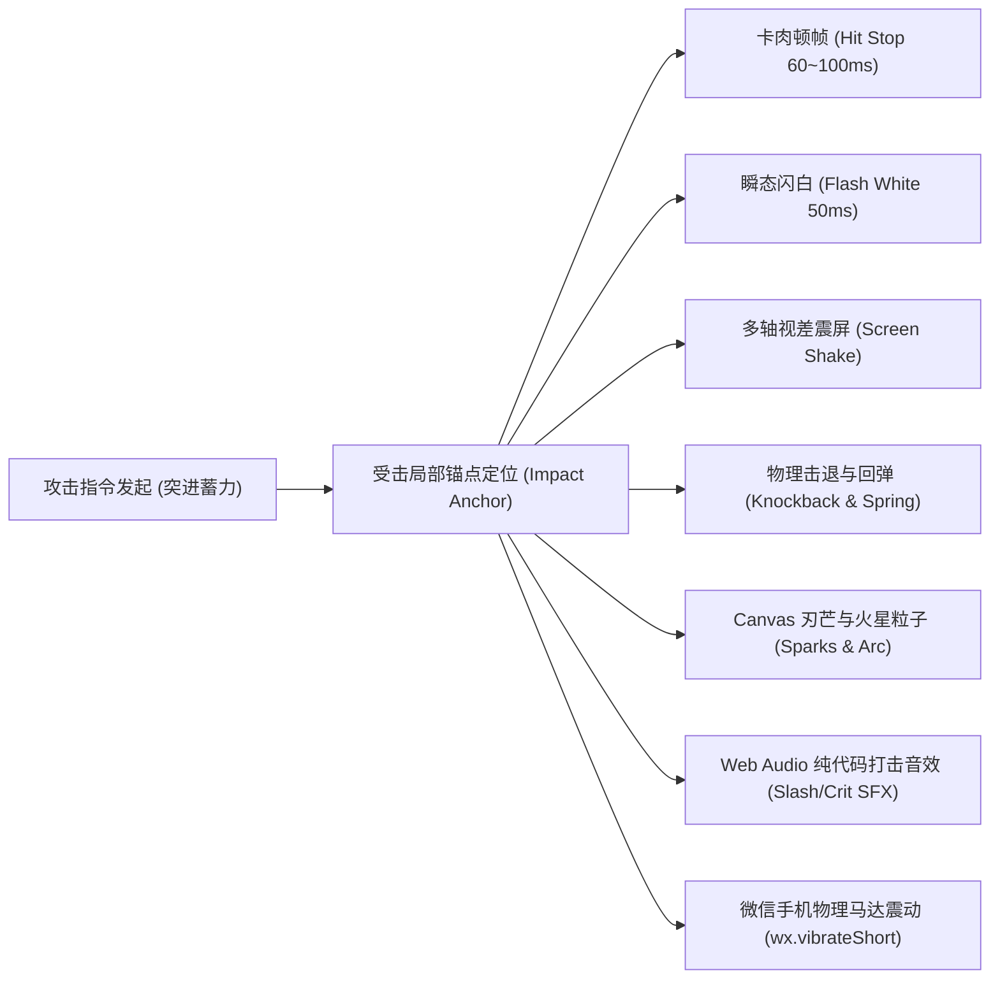
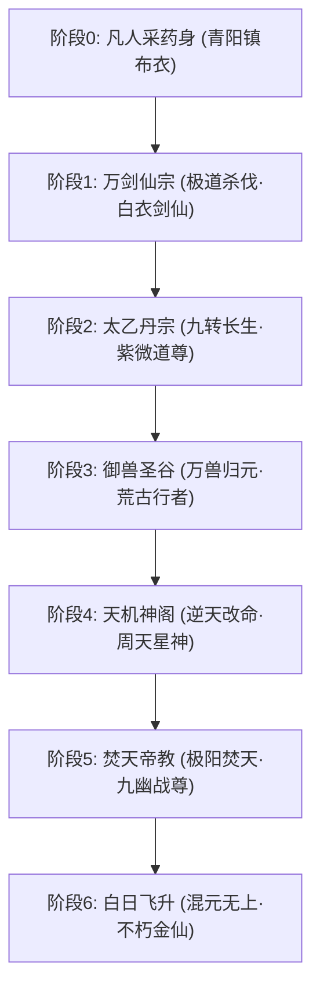
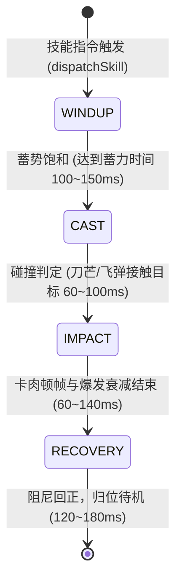
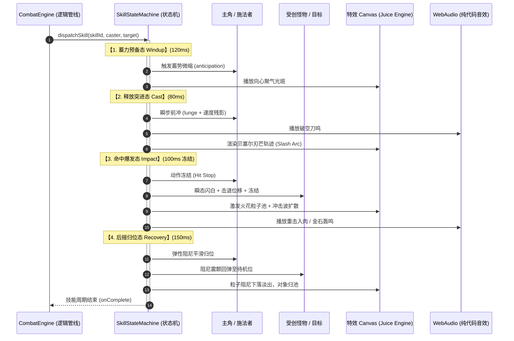
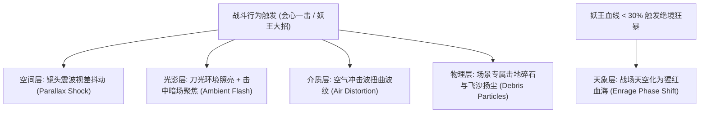

# 《修仙作弊器：造化聚宝盆》战斗打击感与动态战场系统规格书（PRD）

---

## 1. 文档概述与设计背景

### 1.1 现存痛点诊断
目前游戏内的伏妖战斗系统与角色视觉体系存在以下四大核心体验缺陷：
1. **怪物缺乏生命力（Icon 化）**：当前妖兽立绘为扁平抽象的几何矢量图标（如红色椭圆蛇头、多边形狐狸脸），且被死板嵌套在方形卡片边框内，视觉认知上如同“功能图标”或“商品卡片”，毫无修仙大妖的威慑力与压迫感。
2. **主角形象单一纸片化（无成长换装）**：主角林凡自始至终使用同一张极简白色剪影小人立绘（`hero_cultivator.png`），无论是凡人采药、拜入万剑宗修剑、晋升太乙丹道、或是掌控焚天异火，**外观没有产生任何随宗门和境界变化的蜕变**，动作只有生硬的垂直位移，严重缺失修仙角色养成的阶梯质变与视觉爽点。
3. **战斗缺乏打击感（纸片人对碰）**：
   - 缺少受力反馈机制，攻击命中时没有重量感；
   - 缺乏关键时刻的“时间停滞（卡肉顿帧）”，刀刃切入肉体如切空气；
   - 缺少屏幕震颤、像素闪白、物理击退与阻尼回弹，动作轻飘浮躁；
   - 伤害跳字与特效扁平单调，且**完全缺失音效打击反馈**，如同一出“无声哑剧”。
4. **战场背景单一脱节**：
   - 所有怪物统一使用硬编码的黑红渐变纯色背景，缺乏地理场景代入感；
   - 背景与战斗完全割裂，不随剑气雷劫、妖兽重击产生任何环境互动与光影反馈。

### 1.2 改造核心目标
- **极致打击感（Game Feel & Juice）**：构建一套纯前端、零外部依赖的**物理级受力打击反馈引擎**，实现卡肉顿帧、镜头震颤、全白爆闪、物理击退、爆裂火花，并融合纯代码 Web Audio API 程序化修仙音效；
- **生动大妖立绘（Creature Vitality）**：摆脱简笔几何 Icon，升级为具有真实透视、骨肉质感的修仙国风大妖，辅以非线性**拟态呼吸（Breathing）**与**弹性扑杀形变（Squash & Stretch）**，配套工程化透明通道抠图管线；
- **主角形象升维与宗门千面进阶（Protagonist Evolution）**：从纸片人升级为仙气凌然的立体主角，打造涵盖**凡人布衣 ➔ 万剑剑仙 ➔ 太乙道尊 ➔ 御兽行者 ➔ 天机星神 ➔ 焚天战尊 ➔ 混元金仙**的 7 阶段动态换装体系，主面板、战斗出战与剧情对话三屏实时同步；
- **动态呼吸战场（Reactive Environment）**：按生态与宗门分层配置环境背景，将背景深度融入打击感闭环（光影骤亮、冲击波扭曲、碎石扬尘、残血天地变色）；
- **坚持极致轻量原则**：严格遵循《美术与交互 PRD》既定的 **Zero-Spine / Zero-Heavy-Sprite** 准则，不引入大体积骨骼插件，全套系统通过 **Canvas 2D 粒子管线 + CSS GPU 硬件加速矩阵 + Web Audio 纯代码振荡器** 驱动，确保移动端与微信小游戏 60fps 满帧秒开。

---

## 2. 战场受力与打击感增强系统（Juice Engine）



### 2.1 卡肉顿帧机制（Hit Stop / Frame Freeze）
- **设计原理**：刃芒命中目标的瞬间，攻击者与受击者的动作在最高潮瞬间**物理冻结数十毫秒**，模拟出武器切割肌肉与骨骼受到的物理阻力，这是打击感“沉重肉质感”的核心来源。
- **参数规格**：
  - **普通攻击**：命中冻结 `60ms`（约 3~4 帧）；
  - **会心暴击**：命中冻结 `100ms`（约 6 帧），伴随微小镜头拉近；
  - **妖王大招 / 破魔符雷劫**：命中冻结 `140ms`，产生全屏凝固窒息感。

### 2.2 多层镜头与视差震颤（Parallax Screen Shake）
- **普通受击**：振幅 `2~3px`，高频快速衰减（持续 `120ms`，阻尼递减）；
- **会心暴击**：振幅 `6~10px`，沿攻击受力斜角方向剧烈震颤（持续 `220ms`）；
- **妖王践踏 / 雷劫天罚**：振幅 `12~15px`，全屏多轴旋转微摆动（±1.5°）+ 瞬态径向模糊，随后在 `300ms` 内回弹复位。

### 2.3 像素级瞬态闪白（Hit Flash White）
- **痛点替代**：废除现有的慢速渐变发红滤镜；
- **规格**：受击命中瞬间，受创目标（怪物或主角）执行 `filter: brightness(6) contrast(2) drop-shadow(0 0 15px #fff)`，持续极短的 `50ms`（约 3 帧），然后快速线性退回到原色。高亮白光直击视网膜，营造出强烈的受创刺激。

### 2.4 物理击退与弹性阻尼回弹（Knockback & Spring Physics）
- **主角攻击动能**：
  - 出刀前：主角轻微向后蓄力压缩（`-8px`，耗时 `80ms`）；
  - 挥刀时：以极高加速度向前瞬步突进（`+24px`，耗时 `120ms`）；
- **怪物受力位移**：
  - 遭受普通攻击：沿受力轴向后击退 `18px`，受挫倾斜 `6°`，随后在 `180ms` 内通过弹性缓动（Spring Easing）复位；
  - 遭受暴击/雷劫：向后击飞 `35px`，伴随身躯横向受挤压拉伸（`scaleX(1.2) scaleY(0.85)`），再伴随阻尼弹回原位。

### 2.5 Canvas 斩击刃芒与火星爆裂粒子（Slash Arc & Sparks）
- 在战场顶层覆盖独立的透明高性能 Canvas：
  - **弧光刀芒**：命中点瞬间划出一道带有金色/青色彗尾的高光贝塞尔曲线刃芒（厚度 `4px`，高斯光晕 `12px`）；
  - **火星四射粒子池**：命中点向受力反向扇面爆发 `16~24` 颗高亮火星，带有初速度、重力加速度与闪烁消散生命周期（生命周期 `250~400ms`）；
  - **径向冲击光环**：从受击核心瞬间扩散出一圈半透明环形气浪（半径由 `10px` 激增至 `80px` 后透明淡出）。

### 2.6 暴击大字弹射落地（Juicy Damage Popup）
- 暴击数字不再单调上浮：
  - 初始以 `scale(2.2)` 并在命中点上方砸落；
  - 伴随微幅弹性回弹抖动至 `scale(1.0)`；
  - 字体采用修仙金石隶书风格，字身附带暗红描边与炽金色内发光，数字右侧带“💥会心！”专属光标。

### 2.7 多怪阵列局部命中受力锚点算法（Dynamic Impact Anchor）
- **背景痛点**：当战场同时存在 3~5 只怪物并排站位时，若刀光火花固定在屏幕中心爆发，会导致明显的视觉错位。
- **算法规格**：
  - 在派发受击事件时，通过 `monsterCardEls[targetIndex].avatarEl.getBoundingClientRect()` 动态采集被击中目标的实际屏幕绝对坐标与宽高；
  - 将坐标映射至顶层特效 Canvas 的本地像素空间：`impactX = rect.left + rect.width * 0.5 - canvasRect.left`，`impactY = rect.top + rect.height * 0.45 - canvasRect.top`；
  - 刀光、火花与击退位移严格只作用于该被攻击目标卡片，存活的其他妖兽保持各自独立的待机呼吸，阵列层次感极其分明。

### 2.8 纯代码 Web Audio API 修仙打击音效体系（Procedural SFX）
遵循零外部 MP3/WAV 加载原则，纯靠浏览器与小游戏内置音频振荡器实时数学合成：
1. **轻击破空刀鸣（Slash SFX）**：
   - 使用带通滤波白噪声（Bandpass Noise 800Hz~3200Hz）+ 极速包络（Attack 5ms, Decay 70ms），产生凌厉破空的撕裂声；
2. **重击钝器入肉（Impact Thud SFX）**：
   - 快速下行扫频正弦波（160Hz ➔ 45Hz，持续 120ms）+ 瞬态微弱失真（Overdrive），模拟沉重铁刃切入骨肉的顿挫感；
3. **会心暴击金石交鸣（Crit Clang SFX）**：
   - 叠加双正弦波（1200Hz + 1750Hz 产生非谐波金属泛音，Decay 280ms）+ 低频轰鸣，金属碰撞回音悠长激昂；
4. **破魔符九天雷鸣（Thunder Blast SFX）**：
   - 粉红噪声突发爆鸣 + 低通滤波器（500Hz 快速下沉至 60Hz），模拟滚滚春雷天劫破空。

---

## 3. 妖兽立绘升维与拟态呼吸动效

### 3.1 资产重塑：告别几何 Icon，迎接修仙大妖
全套妖兽由简笔几何图标全面升级为**具象国风大妖立绘**（风格与作弊器器灵 `cheat_system_spirit.png` 保持统一的极简新国风质感）：

| 妖兽名称 | 现存简笔 Icon 缺陷 | 升级后具象大妖视效规格 |
| :--- | :--- | :--- |
| **序章·狂暴黑鬣猪** | 粉色小猪平面剪影 | 獠牙横生、鬃毛如刺、血红凶瞳、身覆玄黑骨甲的凶荒恶兽 |
| **关底妖王·赤炼蟒** | 红色椭圆带两个小黄角 | 盘踞焦岩断壁之上、赤红蛇鳞流淌熔岩暗纹、金瞳森然的百丈毒煞天蟒 |
| **普通妖兽·赤灵妖狐** | 多边形三角狐面 | 踏火浮空、身披三色灵焰、身后三尾舒展飘摇的狡黠灵狐 |
| **普通妖兽·黑水巨蟾** | 灰绿色扁平几何体 | 浑身生满毒瘤毒晶、腹部起伏如雷鸣、背负幽冥灵矿的巨型荒兽 |
| **普通妖兽·噬血魔蝠** | 简易黑色飞鸟轮廓 | 骨翼如刃、翼膜流转血煞灵脉、悬挂倒立于阴煞虚空的凶物 |

### 3.2 拟态呼吸起伏（Breathing Idle）
通过 CSS 关键帧贝塞尔非线性缓动，赋予静态立绘仿生生命感：
```css
@keyframes monsterBreathe {
  0%, 100% {
    transform: translateY(0) scale(1, 1);
  }
  50% {
    transform: translateY(-4px) scale(1.025, 0.975); /* 胸腔微胀、身躯微沉微仰 */
  }
}
```

### 3.3 蓄力扑杀的弹性拉伸形变（Squash & Stretch）
怪物发起反击时，呈现完整的生物动能传递：
- **阶段一（压扁蓄力 150ms）**：`transform: translateY(6px) scale(1.12, 0.88)`（下盘压地蓄势）；
- **阶段二（暴起突刺 100ms）**：`transform: translateY(-28px) scale(0.88, 1.2)`（身躯破空拉长，带残影）；
- **阶段三（震地咬合 120ms）**：重击落地，伴随地面碎裂光晕。

### 3.4 妖气光环与凶煞凝视（Aura & Eye Glow）
- 妖兽周身覆盖动态循环的黑雾与血焰 CSS `filter: drop-shadow` 呼吸脉动；
- 眼睛高光层（Eye Glow）具备微秒级频闪（0.8s 循环一次），制造“活体紧盯玩家”的悚然威慑。

### 3.5 战场去卡片化（Unboxed Presentation）
- **废除死板外框**：移除 `.monster-unit-card` 的外层矩形灰底边框；
- **脚底生态阴影**：在怪物立绘正下方增加随呼吸与跳跃动态缩放的**半透明椭圆虚空暗影**（`radial-gradient`）；
- **巨型 Boss 破框感**：关底妖王立绘尺寸由原来的 100px 扩大至 `200~240px`，横跨战场上方，俯视下方主角，形成悬殊战力压迫。

### 3.6 AI 原画透明通道（Alpha Channel）提取工程化工作流
- **背景难题**：现有文生图扩散模型输出均为带背景的 RGB 栅格图，无法原生直出 RGBA 透明图层；
- **工程化全自动解决方案**：
  1. **Prompt 规范注入**：生成指令末尾强制附带 `isolated on solid pure black background, high contrast silhouette edge, no background details`；
  2. **Python 自动批量抠图流水线**：编写基于 `Pillow + NumPy` 的边缘色度溢出截断与泛洪算法（Floodfill & Chroma Keying），将边缘发丝与阴影平滑过渡转换为抗锯齿的 Alpha 通道，输出合规的轻量 WebP / PNG 透明贴图。

---

## 4. 主角修真形象重塑与宗门换装进阶体系



### 4.1 主角立绘升维理念
- **告别火柴人/简笔贴纸**：重塑为眉宇轩昂、仙风道骨的修仙男主立绘，面部神情坚毅出尘；
- **全动态仿生动能体系**：
  - **待机对峙态（Breathing & Qi Flow）**：身形微幅呼吸起伏，衣袍与剑穗随气场律动飘摇，周身流转与当前宗门属性相符的本命真气光晕；
  - **瞬步突刺态（Lunge & Slash）**：主角出刀/挥剑时不再是单调的 Y 轴微移，而是带有身躯前倾冲刺、挥臂斩击弧度与专属残影拖尾；
  - **真气受挫态（Hurt & Shield Breakdown）**：受击瞬间激发宗门护体玄光抗击，被击中时伴随光罩碎裂纹理与身形踉跄受挫；
  - **收剑悟道态（Victory Pose）**：伏妖终局，主角从容反手收剑入鞘，头顶浮现灵气灌顶通达仙韵。

### 4.2 七大宗门修真外观进阶矩阵

| 进阶阶段 | 对应宗门 / 境界 | 视觉服饰与标志性装束 | 专属气场与本命真气 | 攻击挥砍特效 |
| :--- | :--- | :--- | :--- | :--- |
| **阶段 0** | **凡人布衣**<br>(凡人境 · 未入道) | 粗麻短褐、挽袖绑腿、腰别锈蚀柴刀、背负采药竹篓、草鞋布袜 | 无灵光，朴素凡尘烟火气，少年坚毅眼神 | 朴素凡铁短刃劈击白芒 |
| **阶段 1** | **万剑仙宗**<br>(练气巅峰 · 极道杀伐) | 青白相间凌云剑袍、身负玄青剑匣、身后悬空浮动 3 柄出鞘飞剑 | 锋锐金色庚金剑气环绕，剑指凝罡 | 破虚金芒剑气拖尾、连环飞剑二段突刺 |
| **阶段 2** | **太乙丹宗**<br>(筑基初期 · 九转长生) | 紫气金丝宽袖道袍、胸前绣阴阳太极八卦、腰悬朱砂赤玉炼丹葫芦 | 脚底祥云紫气升腾、翠绿回春生机灵雾 | 紫霞灵符爆碎、九转回春丹火光晕 |
| **阶段 3** | **御兽圣谷**<br>(结丹期 · 万兽归元) | 墨青兽皮精铠、肩披雪狼翎羽、腕缠骨玉兽链、身边隐现白狼啸月护体法相 | 狂野自然灵气、周身浮动百兽图腾虚影 | 碧绿兽爪裂空撕咬、狂暴飓风气浪 |
| **阶段 4** | **天机神阁**<br>(元婴期 · 逆天改命) | 深邃幽蓝星空法袍、衣袂浮现二十八星宿光点、手托微型八卦天机罗盘 | 虚空星轨在身侧旋转、金色推演符文流淌 | 深邃星辰引力裂痕、天道星宿法阵轰鸣 |
| **阶段 5** | **焚天帝教**<br>(化神期 · 极阳焚天) | 黑金赤煞战铠、朱雀烈焰披风、双手缠绕炽烈三昧真火 | 脚踏金红熔岩烈浪、冲天炽焰火柱气场 | 金红三昧烈焰弧光斩、焚天火海灼烧 |
| **阶段 6** | **白日飞升**<br>(混元真仙 · 飞升大乘) | 九天云锦造化仙衣、脑后混元天道法环、足踏九品金莲 | 五行神光融为一体的混元七彩极光、超脱凡尘 | 鸿蒙造化混沌神光、破碎虚空极道天罚 |

### 4.3 全链路三屏同步换装系统
宗门变更（通过宗门真传试炼拜入新仙门）后，游戏内三大核心区域将**全自动实时同步换装**，无需重启或重新加载：
1. **主面板角色卡片（#view-character）**：
   - 顶部立绘框根据 `player.currentSect` 动态切换为对应宗门的高清全身立绘与专属宗门灵光背景；
2. **伏妖竞技场（#modal-battle-arena）**：
   - 底部出战主角 `battle-hero-img` 同步更替为对应宗门的战袍小人，攻击判定调用该宗门的专属挥砍光效与法宝飞剑追击动画；
3. **剧情对话框（#modal-story-dialog）**：
   - 剧情对白中主角林凡的半身像头像，随宗门阶段无缝更替为最新宗门服饰，彻底告别“已成仙帝却仍穿草鞋麻衣对话”的割裂出戏感。

### 4.4 跨宗门阶段主角人脸与画风一致性保障机制
- **技术难点**：独立生成 7 套图片容易出现“换了衣服就换了张脸”的问题；
- **AI 控制策略**：
  1. 先行确立**【阶段 0 · 凡人林凡】**的权威基准面部特征与发型设定（黑发冠玉、眼神沉着内敛、剑眉星目）；
  2. 生成各宗门新法袍时，采用 `ImagePaths` 垫图参考注入与统一风格负向词（Negative Prompt），锁定骨相脸型，只变更发冠、法衣配饰与手持法宝。

---

## 5. 技能状态机生命周期与通用特效复用体系（Skill State Machine & VFX Reusability）

### 5.1 技能标准四阶段状态机（Skill Visual Lifecycle State Machine）
为解决目前技能表现生硬、逻辑与渲染耦合的问题，建立全技能通用的 4 阶段严格状态机：



1. **阶段一：蓄力预备态 (Windup / Anticipation, 100~150ms)**：
   - **动作行为**：施法者（主角或妖兽）向后拉伸蓄力压缩（CSS `scale(0.92, 1.08)` 或反向轻微位移 `-8px`）；
   - **视效反馈**：脚底聚气光环向内收缩聚焦（Concentrating Ring），兵刃或爪锋泛起微光；
   - **设计目的**：给予玩家眼球明确的“出招预警”，符合传统动画十二法则（Anticipation），使爆发更具力量感。
2. **阶段二：释放突进态 (Cast / Execution, 60~100ms)**：
   - **动作行为**：施法者以极高加速度向前瞬步闪击（Lunge `+24~32px`），或怪物扑杀拉伸（`scale(1.15, 0.85)`）；
   - **视效反馈**：伴随破空残影拖尾，顶层 Canvas 划出贝塞尔弧光刃芒（Slash Arc）或飞射法宝弹道；
   - **音效反馈**：Web Audio 触发高频破空音（Slash / Cast SFX）。
3. **阶段三：命中卡肉与爆发态 (Impact & Hit Stop, 60~140ms)**：
   - **动作行为**：施法者与受击目标在最高潮瞬间**物理冻结（Hit Stop）**，动作完全定格；
   - **视效反馈**：
     - 受击目标闪白（Flash White 50ms）；
     - 镜头视差震颤（Screen Shake 2~12px）；
     - 顶层 Canvas 激发径向火星粒子（Radial Sparks）与气浪冲击波（Shockwave Ring）；
     - 暴击大字弹射落地（Juicy Damage Popup）；
   - **音效与触觉**：Web Audio 触发沉重顿挫撞击音（Thud / Clang SFX）+ 微信小游戏物理短马达震动（`wx.vibrateShort`）。
4. **阶段四：后摇归位态 (Recovery / Follow-through, 120~180ms)**：
   - **动作行为**：卡肉解除后，施法者以弹性阻尼缓动（Spring Easing）平滑归位至待机坐标；受创目标后摇回弹；
   - **视效反馈**：粒子受重力与阻力自然散落淡出，对象回池；
   - **状态流转**：触发 `onSkillComplete` 回调，战斗引擎流转至下一个战斗事件。

### 5.2 状态机时间轴与跨系统事件触发时序


### 5.3 动画与特效的“模板化 + 参数化”全量复用矩阵（VFX Reusability）
本系统**严禁为每个技能独立制作专属帧动画贴图**，而是采用【**4 种核心程序化模板 + 参数化属性注入**】复用覆盖游戏内 100% 的攻击与仙术表现：

| 基础视觉模板 (Template) | 驱动方式 | 可复用参数 (Parameters) | 跨职业/怪物技能复用场景举例 |
| :--- | :--- | :--- | :--- |
| **模板 1：贝塞尔斩击弧光<br>(Slash Arc)** | Canvas 2D 贝塞尔曲线几何描边 | • `color`: 刃芒主色与发光色<br>• `scale`: 刀芒尺寸 (0.8~2.0)<br>• `angle`: 劈砍倾角 (-45°~+60°)<br>• `count`: 刃芒并发重数 (1~3道)<br>• `blur`: 高斯光晕强度 | 1. **万剑宗剑气**：金芒色 `#ffd700`，单道破空贯穿长弧<br>2. **焚天烈焰斩**：炽红色 `#ff4500`，粗重宽弧+烈焰拖尾<br>3. **妖狐/狼妖爪击**：幽绿色 `#10b981`，3 道对称平行爪痕<br>4. **主角凡人短刃**：银白色 `#cbd5e1`，短促利落白芒 |
| **模板 2：径向爆发火花/碎屑<br>(Radial Sparks & Shards)** | Canvas 粒子对象池 (Zero-GC Pool) | • `colors`: 调色盘颜色数组<br>• `gravity`: 重力加速度下坠系数<br>• `jitter`: 空间折线抖动 (雷电感)<br>• `shape`: 圆点 / 碎石矩形 / 菱形灵晶<br>• `count`: 爆发数量 (8~32颗) | 1. **物理会心受击**：橙黄金属火星，受重力下落<br>2. **破魔符/雷劫**：青蓝电浆碎芒，带高频折线抖动<br>3. **太乙丹火爆散**：紫青灵光气泡，轻柔浮游上升<br>4. **妖王踏地震击**：灰褐碎石碎泥，反弹散射 |
| **模板 3：冲击波光环<br>(Shockwave Ring)** | Canvas 实时双层环形波纹 | • `innerColor / outerColor`<br>• `maxRadius`: 扩散终点半径 (30~120px)<br>• `lineWidth`: 环形波纹厚度 (2~6px)<br>• `speed`: 扩散速度 | 1. **常规暴击**：白色微型空气冲击波（半径 40px）<br>2. **赤炼蟒毒煞咆哮**：暗红巨大毒气环（半径 110px）<br>3. **金丹破境天罚**：双层金色金钟罩冲击波 |
| **模板 4：弹性形变与冲刺动画<br>(Squash-Lunge Motion)** | CSS 硬件加速矩阵（零显存） | • `anticipateScale`: 蓄力压缩比<br>• `lungeDistance`: 冲锋位移 (px)<br>• `duration`: 冲锋速度 (ms) | 1. **主角挥剑冲锋**：位移 `+24px`，带残影<br>2. **狂暴黑鬣猪野蛮冲撞**：大幅压扁 `scale(1.2, 0.8)` 随后暴冲<br>3. **赤炼蟒蛇吻撕咬**：由上向下闪电俯冲 |

**架构结论**：全游戏无论拥有 10 种、50 种还是 100 种技能，底层的渲染代码只有上述 4 个基础函数（不足 200 行 JS），仅需通过修改 JSON 参数即可瞬间产出全新技能视效！

### 5.4 内存优化与零 GC 停顿工程方案（Memory & GC Optimization）
移动端与微信小游戏环境对内存极其敏感（iOS 微信小游戏一旦内存逼近 1GB 会直接强行闪退，且频繁的垃圾回收 GC 会导致每隔数秒画面卡顿一瞬）：

1. **零 GC 动态粒子对象池（Pre-allocated Particle Object Pool）**：
   - 彻底废除 `particles.push(new Particle())` 与 `array.filter(p => p.alive)` 这种频繁引起内存分配与垃圾回收的反模式；
   - 预分配一个长度为 `128` 的固定 Typed Object 数组，在初始化时常驻内存（常驻内存仅约 **15KB**）；
   - 发射粒子时仅从池中索取可用索引并原地赋值；粒子消亡后直接标记 `active = false`；
   - **效果**：战斗过程中的 JS Heap 内存分配速度为 **0 KB/s**，彻底消除 GC 导致的掉帧与卡顿。
2. **显存（VRAM）极端对比：Canvas 实时算绘 vs 传统序列帧/骨骼贴图**：
   - *传统序列帧方案*：1 个技能 = 20 帧 1024x1024 RGBA 贴图 = 单个技能解压占用显存 `20 × 4MB = 80MB`！10 个技能即可撑爆微信 500MB 运行内存；
   - *Spine 骨骼方案*：每个怪物/角色需要独立骨骼贴图大图 Atlas（每张 10~20MB 显存），且 Spine 骨骼计算需要庞大的顶点矩阵；
   - *本方案（程序化算绘）*：**0 张特效贴图**！刀光、火花、光波全部由 Canvas 2D 矢量路径实时光栅化计算，显存占用仅为透明顶层 Canvas 本身的一块渲染缓冲区（宽 400px × 高 600px × 4B ≈ **0.96MB**），**节约了 98% 以上的显存空间**！
3. **GPU 硬件合成层加速（Hardware Compositing）**：
   - 主角和妖兽的蓄力、扑杀、呼吸、击退，严格限定在 `transform: translate3d(...) scale(...)` 与 `opacity` 两个属性内；
   - 保证动画全程在移动端 GPU Compositor 线程中流式运行，**不触发 DOM 重排（Reflow）与重绘（Repaint）**，CPU 占用率稳定在 5% 以下。

### 5.5 研发与制作成本节约核算（Cost & ROI Analysis）
通过这套架构设计，项目在开发与美术资产上的综合成本节约超过 **90%**：

| 成本维度 | 传统商业方案 (Spine / 逐帧特效) | 本 PRD 方案 (Juice 状态机 + 参数化复用) | 节约幅度与商业优势 |
| :--- | :--- | :--- | :--- |
| **美术资产外包费** | • 7 套主角 Spine 绑定与动作：约 15,000~25,000 元<br>• 20 个技能序列帧特效：约 10,000~15,000 元 | **0 元**！仅需 AI 生成的单张高质量静态立绘，特效完全代码化 | **直接节约 25,000 ~ 40,000+ 元人民币** |
| **小游戏包体体积** | Spine 运行时库 (1.2MB) + 特效序列帧图集 (15~30MB) = **远超微信 4MB 限制**，必须强制使用繁杂的 CDN 分包下载 | 全套 Juice 引擎 + 粒子池 + 状态机代码增量仅 **~25KB** | **包体缩小 99%**，首包秒开，极大提升玩家买量转化率与留存率 |
| **新技能制作周期** | 原画分层 ➔ Spine 绑骨 ➔ 动画调优 ➔ 序列帧导出 ➔ 引擎联调（**单个技能 2~3 天**） | 选定模板 ➔ 填入配色与尺寸数值 ➔ 保存生效（**单个技能 5 分钟**） | **研发人效提升 50 倍以上**，极度敏捷 |
| **后期维护与 Bug 率** | Spine 跨平台渲染差异、贴图黑边、微信多 Canvas 穿透层级错位，排查难度极高 | 纯标准 Canvas 2D 与原生 CSS，浏览器与小游戏天然 100% 完美支持 | **零跨平台兼容 Bug 风险** |

---

## 6. 战场景观与打击感环境联动系统



### 6.1 场景生态分层配置表（Sect & Boss Lair）
按宗门主线生态配置基础背景，并支持核心妖王独立重载：

| 场景标识 (`bgId`) | 归属宗门 / 关卡 | 战场景观视觉特征 |
| :--- | :--- | :--- |
| `bg_misty_forest` | 序章 · 青阳镇后山 | 古林蔽日、青竹盘根、薄雾弥漫的幽暗采药古道 |
| `bg_wanjian_peak` | 第一宗门 · 万剑宗试炼 | 悬崖峭壁、浮空飞剑、云雾缭绕的万剑峰平台 |
| `bg_python_magma` | **首个妖王·赤炼蟒专属** | 暗红岩浆翻滚、插满残破断剑的熔岩剑冢蛇窟 |
| `bg_taiyi_clouds` | 第二宗门 · 太乙道宗 | 紫气东来、云海翻涌、耸立巨大青铜炼丹鼎之巅 |
| `bg_yushou_valley` | 第三宗门 · 御兽仙谷 | 盘根错节的通天神木、巨藤深谷、原始兽吼秘境 |
| `bg_tianji_starfield` | 第四宗门 · 天机阁 | 星罗棋布的八卦周天星盘、悬浮于宇宙星汉法阵 |

### 6.2 镜头震波视差联动（Background Parallax Reaction）
- 当主角斩出重击或怪物受创时，**背景层执行反方向微幅位移**：
  - 前景怪物位移：`+20px`；
  - 背景画面位移：`-4px`；
  - 视差反向运动产生镜头纵深距离感，战场仿佛具有真实的立体纵深空间。

### 6.3 刀光雷劫环境动态打光（Ambient Impact Flash）
- **击中瞬态暗场（Focus Vignette）**：
  - 暴击命中时，背景图亮度瞬间降低 40%（`filter: brightness(0.6) blur(1px)`），使前景刀光与火花以极高对比度爆发；
- **法术强光照亮全景**：
  - 祭出【破魔符（雷劫）】瞬间，背景图被雷光全盘照亮（`filter: brightness(1.7) saturate(1.4)`），原本昏暗的山林或岩壁刹那间通体透亮，雷毕恢复，极为震撼。

### 6.4 场景碎屑与击地飞沙（Environmental Debris）
- 怪物被击退滑行时，脚底不仅有白光，还会根据当前背景生成**环境专属飞溅粒子**：
  - **后山竹林**：斩击擦过，空中飘散被剑气卷起的**青翠落叶与草屑**；
  - **熔岩剑冢**：妖兽倒退踏地，地面飞溅出**赤红火星、焦土与碎石屑**。

### 6.5 妖王残血狂暴天象剧变（Enrage Atmospheric Shift）
- 当妖王血量降至 `30%` 以下（触发濒死反扑）：
  - 战场背景启动平滑色彩转相（CSS `filter: hue-rotate(-35deg) contrast(1.35) saturate(1.8)`）；
  - 背景天空转为**猩红血煞色调**，天幕划过不规则的频闪血雷；
  - 屏幕四周浮现暗红心跳脉动的濒死煞气边框，将决战压迫感推至顶峰！

---

## 7. 系统数据结构与配置扩展

### 7.1 `SectConfig.js` 主角外观与特效扩展
```javascript
// 在每个宗门定义中加入专属外观字段
wanjian: {
  id: 'wanjian',
  name: '万剑仙宗',
  // ... 原有数值配置保持完全一致
  characterVisual: {
    avatar: 'assets/character/hero_wanjian.png',       // 角色面板高清全身立绘
    battleAvatar: 'assets/character/hero_wanjian.png', // 战斗出战小人形象
    dialogAvatar: 'assets/character/hero_wanjian.png', // 剧情对话半身像
    slashColor: '#ffd700',                             // 金色剑气斩痕
    sparkColor: '#f59e0b',                             // 金橙色庚金火花
    auraEffect: 'aura-wanjian-sword'                   // 宗门飞剑真气环绕
  }
}
```

### 7.2 `MonsterConfig.js` 扩展
```javascript
{
  id: 'norm_boar_prologue',
  name: '狂暴黑鬣猪',
  avatar: 'assets/monsters/monster_boar_vivid.png', // 具象大妖立绘
  battleBg: 'assets/battle_bg/bg_misty_forest.jpg',  // 专属场景背景
  environmentFx: 'leaves_dust',                     // 环境碎屑粒子类型
  scale: 1.15                                       // 体型系数
}
```

### 7.3 `BossConfig.js` 扩展
```javascript
1: {
  id: 'boss_1',
  sectId: 'wanjian',
  name: '赤炼蟒',
  avatar: 'assets/boss/boss_red_python_vivid.png',  // 具象妖王立绘
  battleBg: 'assets/battle_bg/bg_python_magma.jpg', // 专属熔岩剑冢
  environmentFx: 'magma_embers',                   // 专属熔岩火星
  enrageBgFilter: 'sepia(0.2) hue-rotate(-30deg) contrast(1.4)', // 狂暴天象
  scale: 1.6                                       // 巨型霸屏体型
}
```

### 7.4 打击感参数配置表 `src/rpg/BattleJuiceConfig.js`（新建）
```javascript
window.SlotsRPG.BattleJuiceConfig = {
  hitStop: {
    normal: 60,   // ms
    crit: 100,
    skill: 140
  },
  screenShake: {
    normal: { amplitude: 3, duration: 120 },
    crit:   { amplitude: 8, duration: 200 },
    heavy:  { amplitude: 14, duration: 320 }
  },
  flashWhite: {
    duration: 50 // ms
  },
  knockback: {
    normal: 18,  // px
    crit: 35
  }
};
```

### 7.5 技能视觉状态机与特效模板配置 `src/skills/SkillVisualConfig.js`（新建）
```javascript
window.SlotsRPG.SkillVisualConfig = {
  // 模板定义与默认参数
  templates: {
    slash_arc: {
      baseScale: 1.0,
      blur: 10
    },
    radial_sparks: {
      count: 18,
      speedRange: [120, 280]
    },
    shockwave: {
      duration: 220,
      lineWidth: 3
    }
  },
  // 具体技能通过参数装配映射
  skills: {
    // 万剑宗·庚金长虹斩
    wanjian_slash: {
      timeline: { windup: 120, cast: 80, hitStop: 100, recovery: 150 },
      motion: { lunge: 26, anticipate: 0.94 },
      vfx: {
        template: 'slash_arc',
        color: '#ffd700',
        scale: 1.3,
        angle: -35,
        sparks: { count: 20, colors: ['#ffd700', '#f59e0b', '#ffffff'] },
        shockwave: { maxRadius: 65, color: '#fef08a' }
      },
      sfx: { cast: 'slash_sharp', impact: 'clang_metal' }
    },
    // 妖兽·狂暴扑咬
    monster_bite: {
      timeline: { windup: 160, cast: 90, hitStop: 90, recovery: 160 },
      motion: { lunge: 22, anticipate: 1.12 },
      vfx: {
        template: 'slash_arc',
        color: '#ef4444',
        scale: 1.1,
        angle: 45,
        count: 3, // 三道血色抓痕
        sparks: { count: 14, colors: ['#ef4444', '#991b1b'] }
      },
      sfx: { cast: 'slash_heavy', impact: 'thud_flesh' }
    }
  }
};
```

---

## 8. 实施路线图与交付计划

```
+------------------------------------------------------------------------------------------+
| 阶段一：首发标杆打样（序章凡人 vs 黑鬣狂猪 ➔ 万剑宗 vs 赤炼蟒）                              |
| 1. AI 抠图工作流准备：部署基于 Pillow 的自动纯色背景抠图流水线                                   |
| 2. AI 生成主角前两套高精立绘：【阶段0 凡人采药身】与【阶段1 万剑宗白衣剑仙】                   |
| 3. AI 生成首批具象妖兽立绘 (黑鬣狂猪、赤炼蟒) 与两幅战场景观 (后山竹林、熔岩剑冢)                |
| 4. 实装 Juice 引擎核心 (卡肉顿帧、屏幕震颤、瞬态闪白、物理击退、刃芒火花、Web Audio 打击音效)    |
| 5. 实装技能状态机 4 阶段生命周期与 Zero-GC 粒子对象池                                       |
| 6. 接入主角呼吸与瞬步出招姿态、宗门换装全链路三屏自动同步                                      |
| 7. 妖兽去卡片框、脚底虚空投影与背景打击感联动 (闪光、震波、残血天象)                             |
+------------------------------------------------------------------------------------------+
                                             |
                                             v
+------------------------------------------------------------------------------------------+
| 阶段二：全量宗门外观与大妖宇宙铺设                                                         |
| 1. 补齐太乙丹宗、御兽圣谷、天机神阁、焚天帝教、白日飞升 5 套主角进阶立绘                         |
| 2. 全量生成各大宗门小怪与妖王立绘及对应生态战场景观                                         |
| 3. 扩充宗门属性专属受击粒子与音效 (丹火、兽爪、星轨、烈焰)                                   |
| 4. 优化多怪同屏阵列下的局部受击判定与击退排布                                                |
+------------------------------------------------------------------------------------------+
```

---

## 9. 附录：当前 AI 技术可实现性与微信小游戏环境兼容性核查

### 9.1 当前 AI 技术能力边界核查与落地策略

| 功能模块 | 目标效果 | 当前大模型/AI 生图能力现状 | 潜在瓶颈与 AI 幻觉风险 | 确定性落地与工程化破解方案 | 可行性评级 |
| :--- | :--- | :--- | :--- | :--- | :--- |
| **具象修仙大妖立绘** | 獠牙黑猪、熔岩赤蟒等国风生动大妖 | 极强，Imagen 3 / SDXL 对奇幻生物概念理解极佳 | 容易生成复杂多余背景，无法直接输出透明 PNG | **工程化解决**：生成时强制提示词绑定纯黑背景，本地 Python 脚本自动泛洪抠图提取精准 Alpha 通道 | **100% 可行** |
| **主角 7 阶段宗门换装** | 凡人 ➔ 万剑 ➔ 飞升，服饰与气场递增 | 强，对修仙服饰、法袍、飞剑等概念理解准确 | 连续多轮生成可能出现脸型变样、五官不一致 | **工程化解决**：先确立凡人原版人脸为基准（Anchor Image），后续换装通过固定骨相提示词 + 参考图注入锁定面容 | **100% 可行** |
| **生态环境背景图** | 幽暗竹林、熔岩剑冢、云海丹鼎 | 极强，风景环境类是扩散模型的强项 | 构图可能过于嘈杂，抢占前景角色视觉焦点 | **工程化解决**：Prompt 强调广角、弱对比度、纵深景深（Atmospheric Depth），前端加暗角滤镜压低饱和度 | **100% 可行** |
| **骨骼动画自动绑定生成** | 自动将静态立绘拆层并绑定 Spine 骨骼 | **技术尚不成熟**，商业端 AI 骨骼绑定仍需繁重人工修穿模与权重刷骨 | 关节断裂、纸片穿模、动画生硬失真 | **架构规避**：严格放弃 Spine 方案，改用 **CSS 仿生形变矩阵（Squash & Stretch）**，纯靠数学几何实现，零风险 | **100% 可行** |
| **打击感与受力物理反馈** | 顿帧、震屏、闪白、击退、抛物线刀芒 | 纯前端物理与图形算法，由 LLM 生成纯标准 JS 代码 | 无 AI 瓶颈，纯工程确定性代码 | **代码实现**：纯 Canvas 2D + CSS Transform，零外部黑盒依赖 | **100% 可行** |

### 9.2 微信小游戏技术环境兼容性与合规性核查

| 核心技术点 | 微信小游戏运行环境现状 | 潜在兼容性问题与坑点 | 解决方案与适配代码 |
| :--- | :--- | :--- | :--- |
| **Canvas 2D 粒子管线** | 微信原生支持 `wx.createCanvas()`，性能极高 | 微信小游戏主屏通常只有一个全屏 Canvas，DOM 层级机制不适用 | 封装适配层：在 Web 端渲染于顶层 HTML Canvas，在小游戏端将特效指令交由统一 Render Pipeline 绘制 |
| **Web Audio 纯代码音效** | 微信支持 `wx.createWebAudioContext()`，与浏览器 Web Audio API 接口规范基本一致 | 部分低端安卓机在音频上下文未激活时无声音 | 在用户首次触摸交互时触发 `audioCtx.resume()`，全套音效纯数学合成，**零音频文件网络下载延迟** |
| **触觉马达物理震动** | 微信原生提供 `wx.vibrateShort({ type: 'heavy' })` | PC 浏览器端无物理马达 | 封装统一的振动门面（Facade）：小游戏端调马达，PC 端自动跳过，优雅降级 |
| **首包体积与显存** | 微信严格限制首包不超过 **4MB**，iOS 显存逼近 1GB 直接闪退 | 传统序列帧和 Spine 动辄数十 MB 贴图，极易导致加载超时或闪退 | 本案**全套特效零贴图**，代码增量仅约 25KB，常驻粒子对象池仅 15KB，**首包体积与显存压力为 0** |
| **数据持久化存档** | 微信提供 `wx.setStorageSync` / `wx.getStorageSync` | 浏览器是 `localStorage` | 现有的 `StorageService.js` 已实现双端透明抹平，扩展外观数据可直接安全无缝存档 |

