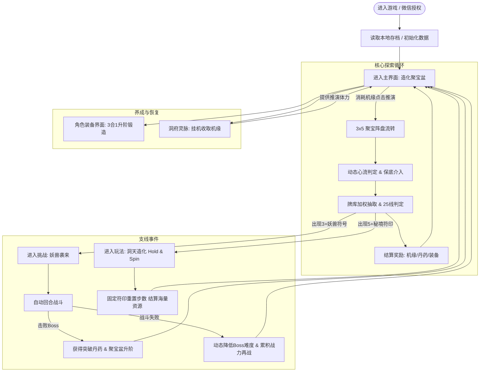

# 《修仙作弊器：造化聚宝盆》系统需求规格书（PRD）

---

## 1. 文档概述与设计原则

### 1.1 项目定位与背景
- **游戏名称**：《修仙作弊器：造化聚宝盆》（暂定）
- **玩法类型**：休闲融合游戏（Slots底层机制 + 放置修仙RPG成长体系）
- **包装方案**：采用**文档Ⅳ的“造化聚宝盆”方案**，将底层 3×5 规格、25 中奖线的老虎机算法完全包装为“修仙天机阵盘 / 造化聚宝盆”。
- **长线世界观与剧情扩展**：详见专项文档 [PRD_剧情与轮回宗门系统规格书.md](file:///e:/my%20games/slots_rpg/PRD_%E5%89%A7%E6%83%85%E4%B8%8E%E8%BD%AE%E5%9B%9E%E5%AE%97%E9%97%A8%E7%B3%BB%E7%BB%9F%E8%A7%84%E6%A0%BC%E4%B9%A6.md)（含凡人序章、五大正宗/干扰商门、九转轮回飞升与灵界大地图）。
  > **合规警示**：全游戏系统与UI层严禁出现“老虎机、拉霸、押注、博彩、赌博”等敏感字眼，全面替换为“推演、运功、消耗机缘、聚宝生灵、天象共鸣”，确保 100% 契合微信小游戏审核规范。
- **运行环境**：微信小游戏（无自建后台服务器，纯前端单机架构，本地持久化与微信云开发结合，集成微信授权登录）。

### 1.2 架构与代码设计准则（面向 AI 工作流）
1. **先框架后业务**：遵循 MVC / 单向数据流，核心计算（数值、概率、保底、战斗）与渲染（Canvas/DOM）彻底解耦。
2. **纯面向对象编程（OOP）**：
   - 核心管理器：`GameManager`（主生命周期调度）
   - 业务引擎：`SlotsEngine`（转轮推演与25线判定）、`FlowController`（心流与动态保底控制）、`CombatSystem`（自动战斗对决）、`InventorySystem`（装备与背包合成）、`CaveManager`（洞府挂机产出）、`StorageService`（存档与微信API封装）。
3. **数据驱动（Data-Driven）**：所有符号、赔率、线网、怪物属性均采用静态 JSON 配置表，严禁硬编码。
4. **AI 协同与 Token 节约规范**：详见《剧情与轮回宗门系统规格书》第 12 章。需求与代码变更强制采用 Diff 局部修改与高密度结构体，严禁在交互中全量复述无关内容，通过里程碑切片归档控制 Context 膨胀。

---

## 2. 总体架构与核心业务流（Game Flow）

### 2.1 整体游戏流程图



### 2.2 三层游戏循环与心流闭环
1. **微观核心循环（0~10秒）**：消耗机缘 $\rightarrow$ 启动聚宝盆（转盘） $\rightarrow$ 伴随期待动效停止 $\rightarrow$ 获得即时机缘反馈/丹药/装备 $\rightarrow$ 维持刺激感。
2. **中观养成循环（1~5分钟）**：背包积攒装备 $\rightarrow$ 进行同品质“3合1升阶” $\rightarrow$ 换装提高攻击/防御/生命 $\rightarrow$ 触发 3 妖兽事件打 Boss $\rightarrow$ 战胜通关突破境界。
3. **宏观挂机与留存循环（1~24小时）**：离线时洞府持续凝聚机缘（上限 2 小时） $\rightarrow$ 上线一键收取 100~200 次旋转机缘 $\rightarrow$ 消耗机缘冲击下一境界。

### 2.3 新手初始化与极端边界仲裁（闭环防卡死）
- **新手初始化（FTUE）**：首次进入游戏自动初始化 `机缘 = 3000`、`聚宝盆等级 = 1`，作弊器弹出初次神念传音气泡，引导玩家完成第一次推演。
- **双事件冲突仲裁（源自文档Ⅱ）**：若单次推演同时命中 $\ge 3$ 个妖兽（战斗）与 $\ge 5$ 个秘印（Bonus）：
  - **执行顺序**：系统优先拉起【妖兽袭来】自动战斗；
  - 战斗结算关闭后，系统**自动紧接着触发【洞天秘境】**，杜绝事件遗漏或逻辑死锁。
- **机缘枯竭防死局兜底**：若玩家机缘 $< 25$ 且洞府离线收益未满，主界面弹出作弊器【聚灵通窍】救济弹窗（免费领取 50 机缘，每日限 3 次；或观看 1 次激励视频获取 100 机缘），确保零成本脱困。

---

## 3. Slots 核心系统（造化聚宝天机阵）

### 3.1 阵盘规格与坐标矩阵
- **阵盘布局**：标准 3 行 × 5 列（共 15 格），坐标索引定义如下：
  ```
  [0,0]  [0,1]  [0,2]  [0,3]  [0,4]  (第0行: 上层)
  [1,0]  [1,1]  [1,2]  [1,3]  [1,4]  (第1行: 中层)
  [2,0]  [2,1]  [2,2]  [2,3]  [2,4]  (第2行: 下层)
   列0    列1    列2    列3    列4
  ```

### 3.2 25 条标准中奖折线（Paylines）定义表
规则：从最左侧第 0 列开始，沿折线连续出现 3 个及以上相同符号（或被 WILD 替代）即为中奖。

| 线路ID | 坐标定义 (列0至列4所在行) | 线路走势说明 | 线路ID | 坐标定义 (列0至列4所在行) | 线路走势说明 |
| :---: | :--- | :--- | :---: | :--- | :--- |
| **Line 1** | `[1, 1, 1, 1, 1]` | 中间直线 | **Line 14**| `[0, 1, 1, 1, 2]` | 缓下对角阶梯 |
| **Line 2** | `[0, 0, 0, 0, 0]` | 顶部直线 | **Line 15**| `[2, 1, 1, 1, 0]` | 缓上对角阶梯 |
| **Line 3** | `[2, 2, 2, 2, 2]` | 底部直线 | **Line 16**| `[1, 0, 1, 2, 1]` | 扁平菱形 |
| **Line 4** | `[0, 1, 2, 1, 0]` | V 字正向开口 | **Line 17**| `[1, 2, 1, 0, 1]` | 倒扁平菱形 |
| **Line 5** | `[2, 1, 0, 1, 2]` | 倒 V 字开口 | **Line 18**| `[0, 0, 1, 2, 2]` | 顶平接下折 |
| **Line 6** | `[0, 0, 1, 0, 0]` | 顶微下凹 | **Line 19**| `[2, 2, 1, 0, 0]` | 底平接上折 |
| **Line 7** | `[2, 2, 1, 2, 2]` | 底微上凸 | **Line 20**| `[1, 2, 2, 2, 1]` | 底长凹槽 |
| **Line 8** | `[1, 0, 0, 0, 1]` | 顶浅凹槽 | **Line 21**| `[1, 0, 0, 0, 1]` | 顶长凹槽 |
| **Line 9** | `[1, 2, 2, 2, 1]` | 底浅凹槽 | **Line 22**| `[0, 1, 0, 1, 0]` | W波浪上方 |
| **Line 10**| `[0, 1, 0, 1, 0]` | 锯齿上波浪 | **Line 23**| `[2, 1, 2, 1, 2]` | M波浪下方 |
| **Line 11**| `[2, 1, 2, 1, 2]` | 锯齿下波浪 | **Line 24**| `[0, 2, 0, 2, 0]` | 大幅Z字跳跃 |
| **Line 12**| `[1, 0, 1, 0, 1]` | 中间起伏小波浪 | **Line 25**| `[2, 0, 2, 0, 2]` | 倒大幅Z字跳跃 |
| **Line 13**| `[1, 2, 1, 2, 1]` | 中间下伏小波浪 | - | - | - |

### 3.3 符号体系与赔率矩阵（Paytable）

游戏共设定 13 种符号，分为：**基础资源类、装备掉落类、功能特殊类**。每次基础单线押注额基数为 1（单次全开 25 线消耗 25 机缘）。

| 符号ID | 符号名称 | 视觉表现形态 | 3连赔率 | 4连赔率 | 5连赔率 | 特殊说明与掉落产物 |
| :--- | :--- | :--- | :---: | :---: | :---: | :--- |
| **SYM_01** | 聚灵符 | 基础淡青符文 | 5× | 15× | 50× | 返还机缘货币 |
| **SYM_02** | 凝神符 | 中级幽蓝符文 | 8× | 25× | 80× | 返还机缘货币 |
| **SYM_03** | 破魔符 | 高级朱砂符文 | 15× | 50× | 150× | 返还机缘货币 |
| **SYM_04** | 气血丹 | 红色灵丹光晕 | 10× | 30× | 100× | 返还机缘 + 永久气血储备 |
| **SYM_05** | 修为丹 | 金色九转金丹 | 20× | 60× | 200× | 奖励角色升级修为值 |
| **SYM_06** | 玄铁剑 | 飞剑剪影（武器） | 5× | 15× | 50× | **必爆武器装备箱**（品阶随聚宝盆等级） |
| **SYM_07** | 青云甲 | 道袍铠甲（防具） | 5× | 15× | 50× | **必爆衣服装备箱** |
| **SYM_08** | 紫金戒 | 灵戒宝光（饰品） | 8× | 20× | 80× | **必爆戒指装备箱** |
| **SYM_09** | 混元履 | 飞靴流光（鞋子） | 5× | 15× | 50× | **必爆鞋子装备箱** |
| **SYM_10** | 捆仙索 | 缠绕灵索（腰带） | 5× | 15× | 50× | **必爆腰带装备箱** |
| **SYM_11** | **万应灵珠 (WILD)** | 混沌金光太极印 | - | - | - | **百搭符号**，仅出现在2、3、4、5列，替代 SYM_01~10 |
| **SYM_12** | **妖兽逆鳞 (SCATTER)**| 咆哮兽首凶煞 | - | - | - | **全盘任意位置出现 3+ 触发挑战关卡** |
| **SYM_13** | **造化秘印 (BONUS)** | 旋转八卦玉佩 | - | - | - | **全盘任意位置出现 5+ 触发洞天秘境** |

### 3.4 纯前端加权牌库抽取算法
为了兼顾单机运行性能与真随机体验，采用成熟的**“分层决策抽取器”**：
1. **第一层：中奖判定（Hit Test）**：
   - 基础命中率（Hit Frequency）：目标控制在 **32% ~ 36%**（即玩家平均每 3 次推演中奖 1 次，符合休闲心流黄金区间）。
2. **第二层：牌库与权重分配**：
   - 若命中奖励：根据当前聚宝盆等级的掉落权重池，决定中奖线类型与连线符号。
   - 若未命中奖励：从预生成的“空转安全滚轮序列”中截取 5 列，确保无任何 25 线达成 3 连，且 SCATTER 数量 $\le 2$。

---

## 4. 动态难度与心流调控机制（Flow & Pity System）

根据国际公认的博彩游戏心理学（Behavioral Reinforcement）与休闲心流模型，本游戏设计三层动态调控机制：

### 4.1 连败回血保底（Loss Streak Mitigation）
- **触发条件**：
  - 玩家连续 **4 次** 空转未获得任何奖励：第 5 次强制提高基础符文权重 100%。
  - 玩家连续 **7 次** 空转：第 8 次触发“天机护佑”，必定命中一条 3 连以上高收益连线（返还本轮机缘并溢出 50%）。
- **心流作用**：消解连续落空产生的挫败感与退游冲动。

### 4.2 差一点就中效应（Near-Miss Anticipation）
- **触发机制**：
  - 当第 0 列、第 1 列均已停止且已出现 **2 个妖兽符号（SCATTER）** 时；
  - 阵盘自动触发**“聚宝蓄力”**状态：第 2、3、4 列转动时间延长 1.5 秒，转动伴随金色符文聚拢特效；
  - 心理学研究表明：Near-Miss 能激活与实际中奖相似的多巴胺分泌回路，显著拉升期待感。

### 4.3 妖兽（SCATTER）与秘境（BONUS）周期保底
- **妖兽保底**：连续 **30 次** 旋转未触发妖兽挑战，计数器满，第 31 次强制在盘面上生成 3 个 SCATTER，开启战斗。
- **秘境保底**：连续 **120 次** 旋转未触发秘境，第 121 次强制触发 5 个 BONUS，进入大奖模式。

---

## 5. RPG 角色与战斗数值系统

### 5.1 角色属性模型与综合战力
- **核心三维基础属性**：
  - **生命值（HP）**：初始 100 点，生存基础，归零即战败。
  - **攻击力（ATK）**：初始 20 点，单次出招伤害基数。
  - **防御力（DEF）**：初始 10 点，减免敌方伤害。
- **综合战力公式（Combat Power）**：
  $$\text{Power} = \lfloor \text{HP} \times 0.2 + \text{ATK} \times 2.0 + \text{DEF} \times 1.5 \rfloor$$
  战力直接在顶栏/角色界面直观呈现，作为角色成长与挑战胜率的核心指引。

### 5.2 角色经验获取途径与升级算法
#### 1. 经验获取三大途径（Exp Sources）
1. **推演保底修为（心流兜底）**：
   - 每次消耗 25 机缘启动聚宝盆，必定保底获得 **+5 经验**（即使空转未中奖也有成长，彻底杜绝负反馈）。
2. **符号连线奖励（暴击爆发）**：
   - 命中 **SYM_05（修为丹）** 连线即刻赋予高额修为值：
     - 3 连：**+50 经验**
     - 4 连：**+150 经验**
     - 5 连：**+500 经验**
3. **妖兽战斗通关（里程碑大奖）**：
   - 击败关卡 Boss（如赤炼蟒、铁甲金猊）：单次奖励 **+300 ~ +1000 经验**。

#### 2. 等级升级经验递增算法（Exp Curve）
采用平滑的超线性幂函数，前期秒升建立正反馈，中期稳步递进，兼顾单机挂机与推演节奏：
$$\text{RequiredExp}(L) = \lfloor 100 \times L^{1.4} + 50 \times L \rfloor$$
其中 $L$ 为角色当前等级（从 Lv 1 起步）。

#### Lv 1 ~ Lv 10 经验与成长阶梯表：
| 角色等级 | 境界称号 | 升级所需经验 | 累计所需经验 | 基础属性 (HP / ATK / DEF) | 综合战力 (Power) |
| :---: | :---: | :---: | :---: | :---: | :---: |
| **Lv 1** | 练气一层 | 150 | 0 | 100 / 20 / 10 | 75 |
| **Lv 2** | 练气二层 | 364 | 150 | 112 / 22 / 11 | 82 |
| **Lv 3** | 练气三层 | 615 | 514 | 125 / 24 / 12 | 91 |
| **Lv 4** | 练气四层 | 896 | 1,129 | 140 / 26 / 13 | 100 |
| **Lv 5** | 练气五层 | 1,202 | 2,025 | 157 / 29 / 14 | 110 |
| **Lv 6** | 练气六层 | 1,531 | 3,227 | 176 / 32 / 16 | 123 |
| **Lv 7** | 练气七层 | 1,880 | 4,758 | 197 / 35 / 17 | 135 |
| **Lv 8** | 练气八层 | 2,247 | 6,638 | 221 / 39 / 19 | 150 |
| **Lv 9** | 练气九层 | 2,632 | 8,885 | 247 / 42 / 21 | 165 |
| **Lv 10** | 练气大圆满 | 3,034 | 11,517 | 277 / 47 / 23 | 184 |

> 注：
> - 角色每升一级，基础属性按复利自然增长：**HP $+12\%$/级，ATK $+10\%$/级，DEF $+10\%$/级**（取整）。
> - 装备属性附加值在角色基础属性之后直接线性相加。

#### 3. 境界突破与卡点规则（Breakthrough）
- **小境界递进（一层至九层）**：经验条蓄满时，自动触发突破动效升级，属性即时提升，溢出经验自动继承到下一级。
- **大境界突破（练气大圆满 $\rightarrow$ 筑基初期）**：
  - 当角色达到 **Lv 10（练气大圆满）** 且经验蓄满时，经验暂时锁死（不再升级），触发【心魔渡劫 / 筑基试炼】。
  - **突破条件**：必须战胜 **关卡 Boss 1（赤炼蟒）**。
  - **突破奖励**：
    1. 成功晋升【筑基初期】，解锁下一阶段等级上限；
    2. 聚宝盆升至 Lv 2（开放新装备掉落池与更高机缘倍率）；
    3. 角色装备槽位解锁新增 3 个：**帽子、鞋子、腰带**；
    4. 乾坤袋背包免费扩容 **+4 格**。

### 5.3 自动战斗结算公式
战斗为纯自动回合对战（单回合无需手动微操），双方交替出手：
$$\text{基础伤害} = \max\left(1, \text{ATK}_{\text{攻}} - 0.5 \times \text{DEF}_{\text{守}}\right)$$
$$\text{最终伤害} = \text{基础伤害} \times \text{Random}(0.92, 1.08) \times (\text{是否暴击 ? 1.5 : 1.0})$$
- 暴击率固定基础值为 $5\%$，暴击伤害 $150\%$。
- 回合上限：20 回合，若 20 回合未分胜负判定玩家失败（防死锁）。

### 5.4 装备品阶与 3合1 升阶锻造规则
- **槽位渐进解锁机制（源自文档Ⅲ）**：
  - **1级聚宝盆（初期）**：仅开放 **武器（主攻）、衣服（防+血）、戒指（攻+血）** 3 大核心槽位，转轮亦仅产出此 3 种装备，极简化初期认知。
  - **2级聚宝盆（击败首个Boss后）**：扩充开放 **帽子（防+血）、鞋子（防）、腰带（防）** 槽位，丰富长线搭配。

#### 品质与数值乘区表
| 品阶代码 | 品阶名称 | 品阶底色 | 属性乘区系数 | 属性浮动区间 | 合成消耗 |
| :---: | :---: | :---: | :---: | :---: | :---: |
| **Q1** | 凡铁（灰） | `#8C8C8C` | 1.0× | 恒定 | - |
| **Q2** | 灵器（绿） | `#52C41A` | 1.8× | $\pm 5\%$ | 3 件相同 Q1 |
| **Q3** | 宝器（蓝） | `#1890FF` | 3.2× | $\pm 8\%$ | 3 件相同 Q2 |
| **Q4** | 法器（紫） | `#722ED1` | 5.8× | $\pm 10\%$ | 3 件相同 Q3 |
| **Q5** | 道器（橙S） | `#FA8C16` | 10.5× | $\pm 12\%$ | 3 件相同 Q4 |
| **Q6** | 仙品（橙SS）| `#F5222D` | 18.0× | $\pm 15\%$ | 3 件相同 Q5 |
| **Q7** | 神品（金SSS）| `#FADB14` | 30.0× | $\pm 20\%$ | 3 件相同 Q6 |

- **合成规则**：3 件同部位同品质装备，合成 1 件高一品质装备。背包支持“一键智能合成”与“广告解锁 10 分钟自动合成”。

### 5.5 关卡 Boss 数值自适应梯队
Boss 属性根据当前聚宝盆等级与玩家在当阶理论“毕业攻击/防御”精准倒推：
- **Boss 1（练气期·赤炼蟒）**：匹配 1 级聚宝盆，血量 2,500，攻击 80，防御 30。
- **Boss 2（筑基期·铁甲金猊）**：匹配 2 级聚宝盆，血量 8,000，攻击 260，防御 110。
- **动态降难机制**：当玩家在同个 Boss 连续战败 3 次，Boss 攻击与血量临时下调 $15\%$，辅助玩家突破心流瓶颈。

### 5.6 乾坤袋（背包与物品管理系统）

背包是承载玩家所有产出资源（装备、丹药、突破材料）的核心容器，设计遵循**“零门槛整理、推演防卡顿、品质强感知”**的原则。

#### 1. 容器结构与容量规划
- **基础规格**：初始开放 **24 格**（4 列 × 6 行网格布局）。
- **扩容体系**：
  - **境界突破赠送**：玩家每次达成大境界突破（如练气 $\rightarrow$ 筑基），永久免费赠送 4 格。
  - **机缘/灵石解锁**：玩家可主动消耗机缘扩容（每开启 4 格消耗 `100 * 扩容次数` 机缘）。
  - **容量上限**：最大可扩充至 **64 格**。
- **分类标签（Tabs）**：
  - 【全部】（综合展示所有物品）
  - 【装备】（仅筛选展示 6 大部位装备）
  - 【丹药】（气血丹、修为丹、突破神丹等消耗品）
  - 【灵材】（进阶材料、宝箱等）

#### 2. 物品存储与堆叠规则
- **装备类物品**：
  - **独占 1 格，不可堆叠**。
  - 每件装备独立持久化记录：`itemId`、`partType`（部位）、`quality`（Q1~Q7）、`mainStat`（基础数值）、`randBonus`（上下限随机浮动值）。
- **消耗品与丹药类**：
  - **同 ID 物品自动堆叠**，单格堆叠上限为 **999**；超出 999 自动占用下一个空格。
- **货币与虚拟代币**：
  - “机缘”与“灵石”直接进入常驻顶栏数值系统，**不占用背包格子**。

#### 3. 推演中“背包满溢”的容错与心流保护（核心机制）
为避免玩家在自动推演或畅爽连击时因“背包已满”被生硬打断，系统设立两道缓冲保护屏障：
1. **第一道防线：智能自动分解（Auto-Salvage）配置**：
   - 玩家可勾选设置：`[ √ ] 推演掉落凡铁(灰)/灵器(绿)时自动分解为机缘`。
   - 命中低级装备时直接在后台折算为机缘进账，不占背包格，推演心流完全不中断。
2. **第二道防线：造化暂存槽（Overflow Buffer）**：
   - 若背包 24/24 满格且未开启自动分解，推演爆出的新装备临时压入隐藏的**造化暂存槽（容量 6 格）**。
   - 若暂存槽也达到 6 格上限，系统**自动强制停止推演**，并弹出【乾坤袋已满】温馨引导弹窗，提供快捷【一键升阶】与【一键分解】按钮，玩家一键清理后即可秒速恢复推演。

#### 4. 穿戴与卸下交互约束（防丢件状态机）
- **穿戴/替换**：
  - 点击背包中的装备并选择【穿戴】：若对应身上槽位为空，装备移入槽位，背包释放 1 格；若槽位已有装备，两者原地互换，背包占用格数不变。
- **卸下操作约束（关键规则）**：
  - 玩家尝试从身上卸下装备时，系统必须即时执行前置判定：`freeSlotsCount > 0`。
  - **当背包已满（0 空格）时**：身上装备详情弹窗中的【卸下】按钮**强制置灰（Disabled）**，点击冒泡提示：“乾坤袋已满，请先整理或分解物品后再卸下”。杜绝因背包满导致卸下装备丢失的严重恶性 Bug。

#### 5. 背包三大快捷管理指令
- **指令一：一键升阶（3合1无损融合）**：
  - 扫描当前背包中所有“同部位且同品质”满 3 件的装备集合；
  - 自动执行融合为高一阶装备。每次成功融合 1 组，背包**净释放 2 个空格**。
- **指令二：一键分解（资源回收）**：
  - 弹窗支持玩家按品质勾选（如默认勾选灰、绿两阶）；
  - 点击一键分解，瞬间批量清空选中品质的所有未锁定装备，并按以下标准返还机缘：
    - Q1 凡铁（灰）：返还 5 机缘/件
    - Q2 灵器（绿）：返还 15 机缘/件
    - Q3 宝器（蓝）：返还 50 机缘/件
- **指令三：一键整理**：
  - 规则优先级：`丹药道具(按ID堆叠) > 高品质装备(Q7->Q1) > 部位分类(武器->衣服->戒指->帽子->鞋->腰带) > 战力高低`。整理后空格统一靠后排列。


## 6. 洞府挂机与整体经济平衡

### 6.1 洞府（灵泉）产出
- **定位**：玩家离线体力安全气囊，保障非付费玩家的推演资源。
- **产出数值**：
  - 1级洞府：每分钟凝聚 3 点机缘。
  - 离线保护时限：上限 **2 小时**（离线最多累积 360 点机缘，折合约 15 次满线推演）。
  - 在线状态：产出无上限，随时间跳字累加。

### 6.2 每日体力与节奏把控
- 每日自然恢复 + 洞府挂机 + 每日任务机缘总额：保证玩家每日拥有 **150 ~ 200 次** 旋转额度。
- 单次游玩时间（Session Time）：预计 8 ~ 15 分钟，完美契合微信小游戏碎片化心流。

---

## 7. 纯前端与微信生态集成规范

### 7.1 本地存储模型（无后端）
- 采用 Key-Value JSON 结构存储在 `wx.setStorageSync('SLOTS_SAVE_V1')`。
- **防作弊时间戳校验**：挂机收益通过记录 `last_logout_timestamp`，在重新进入时比对当前系统时间计算差值，防止用户频繁改手机系统时间。

### 7.2 微信登录与权限
- 启动时静默调用 `wx.login()` 获取临时凭证与微信 OpenID（无需弹窗强求授权手机号）。
- 本地档案直接与 OpenID 强绑定，换机或清除缓存后若接入云开发可一键找回。

---

## 8. 待开发与体验打磨演进路线（Roadmap & Backlog）

在完成阶段一至阶段四的核心玩法闭环（聚宝天机、角色修真、伏妖战场、秘境大奖与洞天灵脉挂机）之后，以下为待补全和体验增强的演进清单：

### 8.1 纯前端仙侠音效系统（Web Audio API 纯代码零外部资源方案）
- **需求背景**：目前全游戏拥有丰富的粒子、流光、震屏与过场动效，但缺乏音效烘托，打击感与推演爽快感仍有提升空间。
- **技术选型**：采用原生 Web Audio API 纯代码实时频率振荡（OscillatorNode）合成，严格零外部音频 MP3/WAV 加载，彻底消除跨域或网络加载延迟障碍。
- **音效规划清单**：
  1. **推演启动与停轮**：阵盘旋转风声、每列停轮清脆金石撞击声（“铛~铛~铛~”阶梯音调）；
  2. **中奖连线与入账**：法宝闪耀清脆泛音、机缘飞流金币入袋清脆水滴音；
  3. **伏妖对决音效**：飞剑破空呼啸拔剑声、妖兽震怒嘶吼低频重音、受击震颤打击音；
  4. **Hold & Spin 秘境**：秘印锁盘厚重古钟铜鸣、引灵灵珠充能点亮音；
  5. **境界突破喜报**：太极圆满庄严仙乐钟磬长鸣；
  6. **系统控制**：顶栏增加全局音效开关（🔊/🔇），状态随本地存档持久化。

### 8.2 推演倍率（下注档位）调节系统
- **需求背景**：随着玩家境界提升与洞天灵脉产出增加，后期拥有数千乃至数万机缘，固定 25 机缘单次推演消耗偏慢。
- **系统规则**：
  1. **档位选择**：支持 1×（25机缘）、2×（50机缘）、5×（125机缘）、10×（250机缘）4 个快捷档位调节；
  2. **等比缩放法则**：
     - 符号连线机缘收益按倍率线性翻倍；
     - 推演保底经验与 SYM_05 修为丹经验按倍率翻倍；
     - 掉落高阶法宝的品质加成权重适度向高阶倾斜；
     - Hold & Spin 秘境中的秘印点数基准按当前下注档位等比放大。
  3. **交互形式**：推演按钮旁设立倍率调节按钮，点击循环切换 `[1x] -> [2x] -> [5x] -> [10x]`。

### 8.3 天机通鉴与规则手册（图文弹窗）
- **需求背景**：新玩家对 25 条折线走势、13 种符号具体倍率、装备 7 阶品质乘区缺乏随时查阅的手册，需要内置清晰说明。
- **内容规划**：
  1. **符号赔率表**：完整图文展示 13 种符号 3 连/4 连/5 连详细收益与特殊产物说明；
  2. **折线走势图**：直观列出 25 条中奖折线矩阵分布缩略图；
  3. **品质与部位谱系**：凡铁、灵器、宝器、法器、道器、仙品、神品 7 阶色彩规范与乘区表，6 大装备部位主属性说明；
  4. **心流保底机制**：公开透明展示连败回血、Near-Miss、周期保底规则。

### 8.4 移动端触觉震动与视口深度适配
- **需求背景**：针对手机端浏览器与微信小游戏环境，强化物理触觉反馈与视口沉浸感。
- **系统规则**：
  1. **振动 API 适配 (`navigator.vibrate`)**：
     - 停轮微震（15ms）；
     - 连线中奖双击节奏震动（20ms, 40ms, 20ms）；
     - 妖兽受创与大奖满盘强震感反馈；
  2. **移动端手势防误触**：禁用下拉回弹橡皮筋与长按呼出系统菜单，视口严格以 `100dvh` 精准撑满，杜绝移动端地址栏伸缩抖动。

