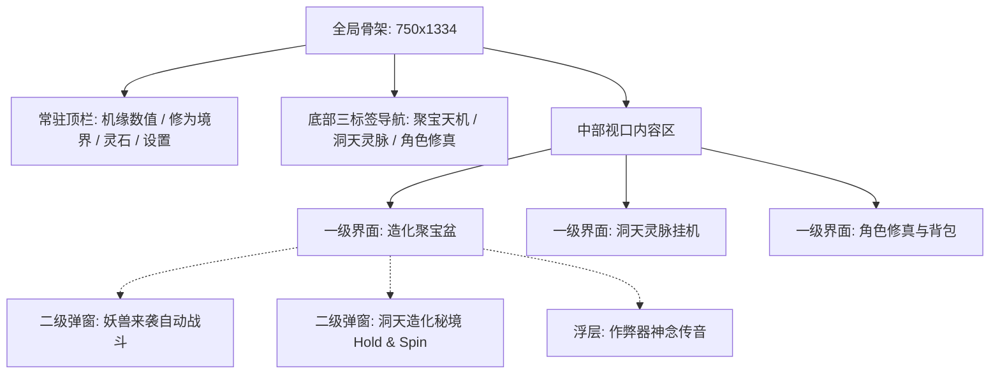

# 《修仙作弊器：造化聚宝盆》美术与交互需求规格书（PRD）

---

## 1. 美术设计定位与基本准则

### 1.1 风格定调
- **设计风格**：**新国风极简修仙（Dark Minimalist Taoism）**。
  - 剔除传统重度仙侠页游的繁复翅膀、流光塑料感与臃肿UI；
  - 采用水墨玄青与虚空墨黑作为主背景，搭配古玉青、星宿淡金、朱砂暗红作为高亮重点色；
  - 图标与符号采用**扁平化高辨识度符文**，兼具道门玄妙感与现代极简美学。
- **核心原则**：
  1. **功能绝对主导**：所有 UI 布局和动效只为传达系统信息（心流状态、数值成长、连线惊喜），不增加任何干扰操作的冗余装饰。
  2. **100% 纯代码生成动效（Zero-Sprite / Zero-Spine）**：
     - **严禁**依赖 Spine、DragonBones 骨骼动画插件；
     - **严禁**使用大体积 PNG 序列帧（降低包体，保障微信小游戏毫秒级冷启动）；
     - 所有视觉动效（旋转、流光、闪烁、震屏、伤害飘字、金光吸收）均通过 **Canvas 2D 动态绘制 / CSS3 硬件加速矩阵变换** 由代码实时渲染。

### 1.2 视口规格与布局规范
- **基准分辨率**：`750 × 1334`（标准 9:16 竖屏，完美匹配主流手机及微信环境）。
- **安全区域适配**：
  - 顶部安全区（Top Margin）：预留 `88px`（避让微信小游戏胶囊按钮）。
  - 底部安全区（Bottom Margin）：预留 `40px`（避让 iOS Home Bar）。

---

## 2. 全局信息架构与界面流转



---

## 3. 一级界面交互与视觉规格

### 3.1 一级界面 1：【聚宝天机】（主界面）

#### 视觉布局示意
```
+---------------------------------------------------+
| [机缘: 3520]      [境界: 练气三层]      [设置/音效] |  <-- 常驻顶栏 (88px)
+---------------------------------------------------+
|                                                   |
|          [作弊器神念: "宿主，聚宝推演将现玄机..."] |  <-- 剧情气泡
|                                                   |
|   +-------------------------------------------+   |
|   |  [ 符 ]   [ 剑 ]   [ 丹 ]   [ 戒 ]   [ 符 ]  |   |  <-- 3x5 聚宝阵盘
|   |  [ 丹 ]   [ 符 ]   [WILD]   [ 兽 ]   [ 甲 ]  |   |      (尺寸 680x420)
|   |  [ 履 ]   [ 丹 ]   [ 符 ]   [ 丹 ]   [ 符 ]  |   |
|   +-------------------------------------------+   |
|                                                   |
|         中奖提示: [天象共鸣! 3连聚灵符 +75机缘]   |  <-- 中奖跑马灯
|                                                   |
|    [25线全开]     [ 消耗: 25机缘/次 ]             |
|                                                   |
|        +---------------------------------+        |
|        |     【 推  演  天  机 】        |        |  <-- 核心交互大按钮
|        +---------------------------------+        |
|        [ ] 自动推演 (连击/长按触发)                |
+---------------------------------------------------+
|   【★聚宝天机】    【 洞天灵脉 】    【 角色修真 】 |  <-- 底部导航栏
+---------------------------------------------------+
```

#### 详细操作交互说明
1. **推演按钮操作**：
   - **单次轻触（Click）**：
     - 若机缘 $\ge 25$：扣除 25 机缘，按钮进入置灰禁用态，阵盘 5 列滚轮依次以 0.08 秒间隔启动高速垂直流转动效。
     - 若机缘 $< 25$：弹出轻量气泡提示：“机缘耗尽，可前往洞天引灵或调息”，推演按钮抖动提醒。
   - **长按（Long Press $\ge 0.8s$）**：
     - 激活“自动推演（Auto-Spin）”模式，按钮外圈出现金色环形流光呼吸动效，阵盘将在每次结算完毕后自动间隔 0.5 秒开启下一轮。
     - 再次轻触屏幕任意位置立即打断自动推演。
2. **滚轮停止与中奖判定交互**：
   - 滚轮第 0 至 4 列默认以每列间隔 0.2 秒由左向右顺次“急停回弹”（Back.easeOut 缓冲）。
   - **连线高亮轮播**：
     - 若命中 25 线奖励，命中格子的边框由暗淡转为**金光高亮（金色 Canvas 描边脉冲 2 次）**。
     - 多条连线中奖时，先全盘闪烁 1 次，随后按线路顺次高亮显示中线路径并伴随中奖机缘飞向顶栏。
   - **打断跳过（Skip）**：在转轮转动或结算播放时再次点击按钮，立即跳过动画，瞬间显示最终停轮盘面与数值增减。

---

### 3.2 一级界面 2：【角色修真与乾坤袋（背包）】

#### 视觉布局示意
```
+---------------------------------------------------+
| [机缘: 3520]      [战力: 18,450]        [境界: 练气三层]|  <-- 顶栏
+---------------------------------------------------+
|      [武器]       +-------------+       [帽子]    |
|     (玄铁剑Q3)    |             |      (紫霄冠Q2) |
|      [衣服]       |   修仙者    |       [戒指]    |  <-- 角色纸娃娃槽位
|     (青云甲Q4)    |  剪影立绘   |      (须弥戒Q3) |      (6大装备槽)
|      [腰带]       |             |       [鞋子]    |
|     (混元索Q2)    +-------------+      (行云履Q2) |
+---------------------------------------------------+
| 基础属性: 生命 [ 3200 ]   攻击 [ 540 ]   防御 [ 280 ] |
+---------------------------------------------------+
| 乾坤袋 [ 全部 | 装备 | 丹药 | 灵材 ]    [ 空间: 18/24 [+] ] <-- 分类与扩容
| +----+ +----+ +----+ +----+                       |
| | 剑 | | 剑 | | 剑 | | 甲 |  (4x6 格子矩阵,       |
| +----+ +----+ +----+ +----+   每格 140x140px,     |  <-- 背包网格区
| | 丹 | | 丹 | | 戒 | | [锁]|   带品质光框与角标)  |
| +----+ +----+ +----+ +----+                       |
| [ 一键整理 ]  [ 一键分解 ]  [ 一键升阶(3合1) ]     |  <-- 三大快捷操作栏
| [ √ ] 自动推演时自动分解灰/绿装备  [广告免操作: 08:42] |
+---------------------------------------------------+
|   【 聚宝天机 】    【 洞天灵脉 】    【★角色修真】 |  <-- 底部导航
+---------------------------------------------------+
```

#### 格子视觉状态规范（纯代码 Canvas/CSS 渲染）
1. **空格子**：底色 `#141923`，边框 `1px solid rgba(255,255,255,0.08)`，圆角 `8px`。
2. **有物品格子**：
   - 内嵌 80×80px 居中符号（剑、甲、丹等扁平矢量图形）；
   - 外边框采用对应品质高亮色（Q1灰 `#8C8C8C`、Q2绿 `#52C41A`、Q3蓝 `#1890FF`、Q4紫 `#722ED1`、Q5橙 `#FA8C16`、Q6红 `#F5222D`、Q7金 `#FADB14`）；
   - **高阶呼吸特效（Q5及以上）**：外边框叠加纯 CSS `box-shadow: 0 0 12px <品质色>` 呼吸渐变。
   - **堆叠角标**：丹药类格子右下角以半透明黑底胶囊标签显示堆叠数字（如 `×45`）。
3. **未解锁锁定格**：暗锁暗纹水印，居中显示淡灰色铜锁图标 `[ 🔒 ]`，点击直接触发扩容确认浮层。
4. **空间容量指示状态（颜色预警）**：
   - 剩余空间 $> 4$ 格：白色文字 `18/24`；
   - 剩余空间 $1 \sim 4$ 格：黄色预警文字 `22/24`；
   - 满格（$0$ 格）：红色闪烁警示 `24/24 [满]`，右侧 `[+]` 扩容按钮微颤提示。

#### 详细操作交互说明

1. **装备点击与详情对比弹窗（Tooltip Modal）**：
   - **轻触背包内装备**：屏幕中央半透明蒙层淡入【法宝通鉴】详情卡片。
     - 显示：装备图标、品质色名称、主属性（攻击/防御/生命值）、浮动随机数值条；
     - **实时属性对比**：自动比对当前身上同部位装备，以 `▲ +35 攻击 (提升)`（绿色）或 `▼ -10 防御 (下降)`（红色）标注；
     - 底部操作按钮：
       - 【穿戴/替换】：装备直接移入角色槽位，身上原装备退回当前格子；若背包原本已满则原地无缝互换。
       - 【单件分解】：分解该单件装备并弹出“获得 +XX 机缘”微光粒子。
       - 【关闭/点击空白区域】：弹窗快速缩放淡出（150ms）。
   - **轻触身上已穿装备**：呼出详情弹窗，底部仅有【卸下】按钮。
     - **关键约束（防爆包拦截）**：
       - 若背包有空格（`freeSlots > 0`）：【卸下】按钮高亮可用，点击将装备移入背包空格；
       - 若背包已满（`freeSlots == 0`）：【卸下】按钮强制置灰（Disabled，透明度 40%），点击屏幕正中弹出气泡：“乾坤袋已满，无法卸下法宝，请先清理空间！”。

2. **三大管理操作交互流程**：
   - **操作 A：【一键整理】**：
     - 点击后，背包内所有网格执行快速洗牌聚拢动画（0.25s 网格位移插值）；
     - 堆叠丹药靠前并合并相同 ID，装备按品质从高到低排列，所有空闲格子整齐后置。
   - **操作 B：【一键分解】**：
     - 点击呼出【快速熔炼】二级弹窗，包含多选复选框：`[ √ ] 凡铁(灰)   [ √ ] 灵器(绿)   [ ] 宝器(蓝)`；
     - 下方实时统计：“本次预计分解 X 件装备，可回收 Y 点机缘”；
     - 点击【确认熔炼】，选中的低阶装备瞬间化为纯代码金色粒子汇入顶栏机缘池，对应格子瞬间清空。
   - **操作 C：【一键升阶（3合1）】**：
     - 点击后系统自动检索所有达成“同部位、同品阶、满3件”的装备集；
     - 3 个装备格子同时亮起金色八卦阵光圈，沿贝塞尔弧线向中心格汇聚并发出“叮”清脆金石音效，升阶为一件高一品质的新装备，原地腾出 2 个空格。

3. **背包满溢时的被动推演拦截交互（核心体验保护）**：
   - 当玩家在主界面推演，若背包与 6 格暂存槽均已爆满：
   - 系统自动暂停当前推演动画，屏幕正中弹出醒目古卷弹窗：
     > **【乾坤囊满，造化难收】**  
     > 宿主储物空间已达上限，继续推演将遗失宝物！  
     > [ 一键升阶融合 ]    [ 一键快速分解 ]    [ 开启新格子(+4) ]
   - 玩家点击任意一键处理按钮即可在弹窗内直接解决空间危机，关闭后自动恢复顺畅推演。


### 3.3 一级界面 3：【洞天灵脉】（挂机产出）

#### 视觉布局示意
```
+---------------------------------------------------+
| [机缘: 3520]      [洞天境界: 翠竹幽居]             |
+---------------------------------------------------+
|                                                   |
|                     ( 灵 气 祥 云 )                |
|                                                   |
|                +-------------------+              |
|                |    灵 泉 仙 鼎    |              |
|                |   (水波荡漾代码)   |              |
|                +-------------------+              |
|                          |                        |
|             [ (O) 凝聚机缘: +280 ] (悬浮微光气泡) |
|                                                   |
| 离线蓄灵槽: [==========          ] 120/120分 (已满)|
| 当前灵涌速度: 3 点机缘/分钟                       |
|                                                   |
|        +---------------------------------+        |
|        |       【 引 灵 入 体 (一键收取) 】|        |
|        +---------------------------------+        |
|                                                   |
| 洞天突破: 消耗修为丹升阶为 [灵溪福地] (产出 +50%)  |
+---------------------------------------------------+
|   【 聚宝天机 】    【★洞天灵脉】    【 角色修真 】 |
+---------------------------------------------------+
```

#### 详细操作交互说明
1. **一键收取机缘**：
   - 点击【引灵入体】或直接点击悬浮的【机缘气泡】：
   - 气泡爆碎为若干由小到大的金色光点，呈贝塞尔抛物线飞入顶栏【机缘】显示区，数字快速递增滚动播放跳字音画反馈。
2. **满溢与心流引导**：
   - 达到 2 小时离线上限后，进度条呈金色呼吸闪烁状态，并提示“灵泉已盈，速速收取以防造化外溢”。

---

## 4. 二级弹窗与核心事件交互规格

### 4.1 妖兽来袭（自动战斗场景）
- **触发条件**：主盘面任意位置停出 $\ge 3$ 个【妖兽逆鳞 (SCATTER)】。
- **转场表现**：
  - 阵盘瞬间覆盖水墨撕裂全屏滤镜，背景音乐转为急促金戈肃杀交响；
  - 界面中央浮现巨幅妖兽立绘剪影及威压血条。
- **战斗交互机制**：
  - **纯全自动**：无需玩家手动点击技能，每回合间隔 `0.6秒`。
  - **攻击表现**：
    1. 角色方亮起剑光，一道白色弦月弧光斩向妖兽；
    2. 妖兽受击，怪物立绘产生 `8px` 高频水平振动（代码振幅衰减）；
    3. 暴击或受击数值以金色大字向上漂浮淡出；
    4. 双方顶部血条平滑消融缩短。
- **战利品结算弹窗**：
  - 击败 Boss 后弹出古卷金榜：“伏妖大捷”，逐一展示通关奖励（大量修为丹、突破神丹、高级装备箱），点击任意处返回主界面并直接升级聚宝盆。

---

### 4.2 洞天造化秘境（Hold & Spin 玩法）
- **触发条件**：主盘面任意位置停出 $\ge 5$ 个【造化秘印 (BONUS)】。
- **特殊规则与交互表现**：
  1. **盘面重塑**：其余常规符号全部变灰半透明，触发的 5 个秘印固定在盘面上并浮现随机机缘倍数（如 `×5`、`×10`）。
  2. **逆天步数计数器**：顶部悬浮展示三颗灵珠：“剩余引灵次数：[● ● ●]”。
  3. **旋转与重置心流**：
     - 其余未固定的格子开始独立旋转；
     - 只要转出新的【造化秘印】，该位置立即被金色锁链锁死，同时将剩余次数**重新重置为 3 次**；
     - 若连续 3 次均未转出新秘印，秘境探寻结束。
  4. **全盘满溢大奖（Jackpot）**：若 15 个格子全部填满秘印，触发全屏金色流光与“乾坤圆满”天道大奖。

### 4.3 双事件冲突无缝衔接表现
- 若单次推演同时命中 $\ge 3$ 妖兽与 $\ge 5$ 秘印：
  - 界面先执行【妖兽来袭】战斗与结算；
  - 战斗结算面板关闭的瞬间，盘面无需返回主界面，直接无缝触发【造化秘印】金链锁盘动画进入秘境，保证两重爽感连贯爆发。

### 4.4 作弊器神念气泡与机缘救济弹窗
- **初入引导气泡**：主盘面上方悬浮半透明水墨气泡：`【作弊器】“散修得道，此乃天机聚宝盆，推演可逆天改命...”`，点击气泡或推演大按钮瞬间关闭引导。
- **机缘枯竭救济弹窗**：机缘耗尽且灵泉未产出时，弹出居中古卷卡片：`【灵机已竭】“向天借法，吸纳天地游离灵气”`，提供简洁大按钮 `[ 领取灵机 (+50) ]`，点击后直接转化为金色光雨注入顶栏。

---

## 5. 纯代码动效技术实现规格（面向工程师/AI）

所有动效均在 **HTML5 Canvas** 单画布或 CSS3 变换上直接通过代码实现，无外部重量级依赖：

### 5.1 转轮运动模糊与停轮缓冲（Reel Motion Blur）
- **原理**：高速运转时，符号 Y 轴坐标以 `Speed = 35px/frame` 递增。
- **模糊实现**：在 Canvas 绘制符号前，叠加透明度为 `0.3` 的上下错位重影，形成视觉暂留与速度线。
- **缓冲函数**：停轮采用自定义 `easeOutBack` 插值算法：
  $$\text{easeOutBack}(t) = 1 + c_3 \cdot (t - 1)^3 + c_1 \cdot (t - 1)^2 \quad (c_1 = 1.70158, c_3 = c_1 + 1)$$
  使滚轮停下时产生轻微下沉并瞬间弹回的“机械撞击质感”。

### 5.2 差一点就中（Near-Miss）期待减速
- 当第 0、1 列出现 2 个 SCATTER 时：
  - 核心逻辑：触发 `ReelAnticipationState = true`；
  - 表现：第 2、3、4 列转速由 `35px` 强制降至 `12px`，同时在该列外框用 Canvas 动态绘制金色循环旋转光环（`ctx.arc` + `shadowBlur = 15`），音效与画面张力延长 1.5 秒。

### 5.3 25 条中奖折线动态绘制与光斑流淌
- 当计算引擎返回中奖线路 ID 时：
  - 获取该线对应的 5 个中奖格子中心点坐标 $(X_0, Y_0)$ 至 $(X_4, Y_4)$；
  - 调用 `ctx.beginPath()`，采用金色半透明画笔（`rgba(255, 215, 0, 0.8)`）沿连线依次连接；
  - 开启 `requestAnimationFrame`，利用 `lineDashOffset` 使光斑在折线上平滑流动，直观传达中奖链路。

### 5.4 纯代码粒子发射器系统（Object Pool Particles）
- **性能红线**：同屏活跃粒子上限限定为 **80 颗**，复用对象池，杜绝垃圾回收（GC）卡顿。
- **粒子行为**：
  - 爆奖粒子：自聚宝盆中心沿随机角度辐射喷发，带重力加速度 `g = 0.5` 与阻尼系数 `0.96`；
  - 飞行动画：粒子按二阶贝塞尔曲线平滑收敛飞入顶部金币栏，落地时触发图标缩放弹性振颤（Scale from 1.0 $\rightarrow$ 1.25 $\rightarrow$ 1.0）。
